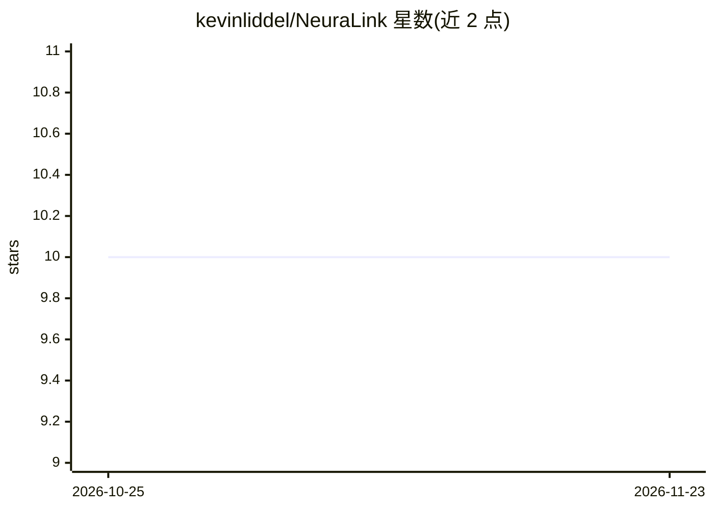

# kevinliddel/NeuraLink

⭐ 10 · Swift · MIT · 推送 2026-11-12 · [GitHub](https://github.com/kevinliddel/NeuraLink) · 个人维护

**iOS 用户：Metal 渲染 VRM 虚拟角色 + 在线/离线 AI 语音伴侣**

基于 Metal 与 SwiftUI 的原生 iOS VRM 角色查看器与 AI 伴侣应用。云端路径通过 WebRTC 接入 OpenAI Realtime API 进行低延迟语音对话；离线路径用 whisper.cpp 做语音识别、llama.cpp 在 Metal GPU/CPU 上运行 Llama-3.2 与 LLM-jp-3、VOICEVOX/OpenVoice 合成语音。包含自定义 MToon 着色器、Spring-Bone 物理程序化天空与雨、唇形同步、生成式动作、端上事实记忆与工具调用。需 iOS 26.2+、iPhone 11 或更新机型；大体积资源首次使用时从 Hugging Face 下载并校验 SHA-256。

## 筛选速览

| 维度 | 判定 | 备注 |
|---|---|---|
| AI 角色 | `ai-native` | 本体是模型或模型工具 |
| 许可风险 | `permissive` | MIT |
| 部署形态 | `None` |  |
| 模型依赖 | local-ok | 支持本地模型 |
| 硬件要求 | — | 无带数字的原话,不猜 |
| 安装摩擦 | `low` | 无编译、无系统依赖或容器化 |
| 成熟度 | — | 结构信号不足 |

## 能力要点

- 双后端语音架构：OpenAI Realtime 云端路径与 whisper.cpp/llama.cpp 离线路径
- 自定义 Metal 渲染管线：MToon 着色器、GPU morph target、MSAA 与描边
- 端上 Agentic Memory：事实类型、实体图与混合召回
- Silero VAD v5 客户端 VAD 与 OpenAI 服务端 VAD 双层语音检测

## 适用场景

- 在 iPhone 上与 VRM 虚拟角色进行实时语音对话
- 无网络环境下用端上模型保持 AI 伴侣可用
- 加载 VRoid 制作的 VRM 角色并自定义外观
- 用语音指令创建提醒、查天气、播放音乐

## 场景标签

`语音 Agent` · 领域:对话与助手

## 证据(README 行号)

> L19: A high-performance, native iOS VRM character viewer and AI companion built from the ground up using **Metal** and *
> L48:  Fully Offline AI whisper.cpp (STT), Llama-3.2 / LLM-jp-3 (LLM) via llama.cpp on the Metal GPU or CPU, and OpenVoic

## 星数曲线

2026-10-25 10 → 2026-11-23 10（+0）

---
*卡片 v1 · prompt 1.4 · 生成 2026-11-19 · 置信度 high · 依据 README sha `87d5f6c90630` · [字段定义](../../DATASET.md)*
