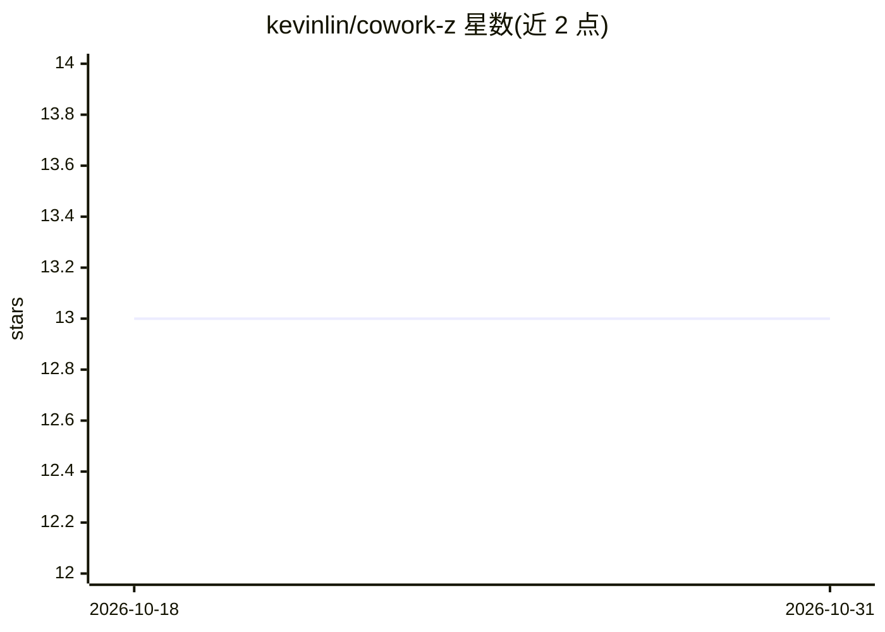

# kevinlin/cowork-z

⭐ 13 · TypeScript · MIT · 推送 2026-10-28 · [GitHub](https://github.com/kevinlin/cowork-z) · 个人维护 · 中文 README

**本地优先的 AI 桌面工作区：在私有环境运行 AI agent 任务**

基于 Tauri 2.x（Rust+Web）构建的跨平台桌面应用（macOS 提供 dmg，Windows/Linux 有构建），以 OpenCode 为 AI 引擎。按项目组织工作区，agent 在本地读写文件，提供目录级权限控制与运行时授权提示。支持 12+ 提供商（Anthropic、OpenAI、Gemini、AWS Bedrock、Ollama 等），凭据存入 OS Keychain。功能含定时自动化任务、Arena 三模型并行对比、技能目录/管理器（SKILL.md）与 MCP 服务器接入。macOS 功能完整，Windows 处于开发阶段。

## 筛选速览

| 维度 | 判定 | 备注 |
|---|---|---|
| AI 角色 | `ai-native` | 本体是模型或模型工具 |
| 许可风险 | `permissive` | MIT |
| 部署形态 | `desktop` | 安装包/桌面程序 |
| 模型依赖 | local-ok | 支持本地模型 |
| 硬件要求 | — | 无带数字的原话,不猜 |
| 安装摩擦 | `low` | 无编译、无系统依赖或容器化 |
| 成熟度 | `idea` | |

## 能力要点

- 按项目隔离的本地工作区，agent 本地读写文件，凭据存 OS Keychain
- 12+ AI 提供商接入，Arena 三模型并行对比同一提示词
- cron 定时自动化任务，由 Rust 调度器驱动无人值守运行
- 技能目录/管理器（SKILL.md、Git 仓库源）与 MCP 服务器支持

## 适用场景

- 在本机用 AI agent 处理私有代码和敏感数据
- 定时让 AI 巡检文件或代码并汇总发现
- 并排对比多个模型在同一任务上的输出

## 场景标签

`AI 助手` · 领域:对话与助手

## 证据(README 行号)

> L219: Type a prompt in the launcher (or press **`Cmd + N`**) and hit Enter. The agent will plan, execute, and report bac
> L27: Whether you're a developer protecting proprietary code, a researcher with sensitive data, or a knowledge worker who
> L243: |AI Engine|OpenCode via Node.js sidecar|

## 星数曲线

2026-10-18 13 → 2026-10-31 13（+0）

---
*卡片 v1 · prompt 1.4 · 生成 2026-10-31 · 置信度 high · 依据 README sha `08c4adb65533` · [字段定义](../../DATASET.md)*
