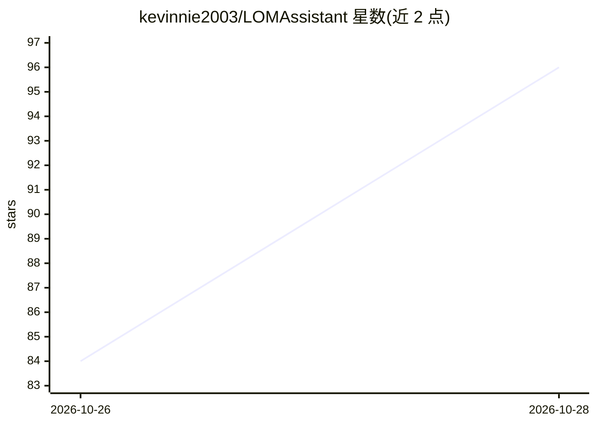

# kevinnie2003/LOMAssistant

⭐ 102 · C# · 推送 2026-10-28 · [GitHub](https://github.com/kevinnie2003/LOMAssistant) · 个人维护 · 中文 README

**《活侠传》全能游戏 Mod：AI 陪玩、剧情回顾与存档优化**

基于 BepInEx 6 的《活侠传》单机游戏 Mod，功能覆盖五类：AI 陪玩（自带 API Key 接入大模型，先查剧情数据再回答攻略，可与九位女主角、大师兄角色对话，支持剧透程度控制与数值修改确认）、剧情回顾（此刻/路线图/剧情图/收集进度）、剧情辅助（分支自选、随机事件自选、选项结果显示）、存档优化（随时存档 100 个、回退判定、更多栏位）、F9 数值面板与养成战斗开关。通过压缩包安装器或手动解压安装，Linux/Steam Deck 需手动加环境变量。

## 筛选速览

| 维度 | 判定 | 备注 |
|---|---|---|
| AI 角色 | `ai-enhanced` | 去掉 AI 部分产品仍成立 |
| 许可风险 | `none` | — |
| 部署形态 | `desktop` | 安装包/桌面程序 |
| 模型依赖 | — | README 未给出锁定关系 |
| 硬件要求 | — | 无带数字的原话,不猜 |
| 安装摩擦 | `medium` | 含编译或系统依赖之一 |
| 成熟度 | — | 结构信号不足 |

## 能力要点

- AI 陪玩接入 DeepSeek/Kimi/通义/Claude/Gemini/本地 Ollama 及任意 OpenAI 兼容接口
- 攻略助手先查游戏内剧情数据再回答，含任务条件、分支对白、路线好感合计
- 随时存档不占原版存档栏、节点存档跟着 Steam 云同步
- 路线图/剧情图/旗标反查等剧情导航功能

## 适用场景

- 玩《活侠传》时向 AI 问剧情走向和攻略
- 想看全部分支、结局和收集进度
- 随时存档并回退到剧情判定前重试
- 用数值面板调整角色属性和好感

## 场景标签

`聊天机器人` · 领域:对话与助手

## 证据(README 行号)

> L7: 《活侠传》（Legend of Mortal）的 BepInEx 6 插件。适配最新版游戏，并加入 AI 陪玩、剧情回顾、分支自选、修改面板、存档优化等功能。
> L46: 用自己的 API Key 接入大模型，问剧情和攻略，或者和女主角、大师兄聊天。支持 DeepSeek、Kimi、通义千问、智谱 GLM、硅基流动、OpenRouter、OpenAI、Claude、Gemini、本地 Ollama，

## 星数曲线

2026-10-26 84 → 2026-10-28 96（+12）

---
*卡片 v1 · prompt 1.4 · 生成 2026-10-27 · 置信度 high · 依据 README sha `e99bda939f82` · [字段定义](../../DATASET.md)*
