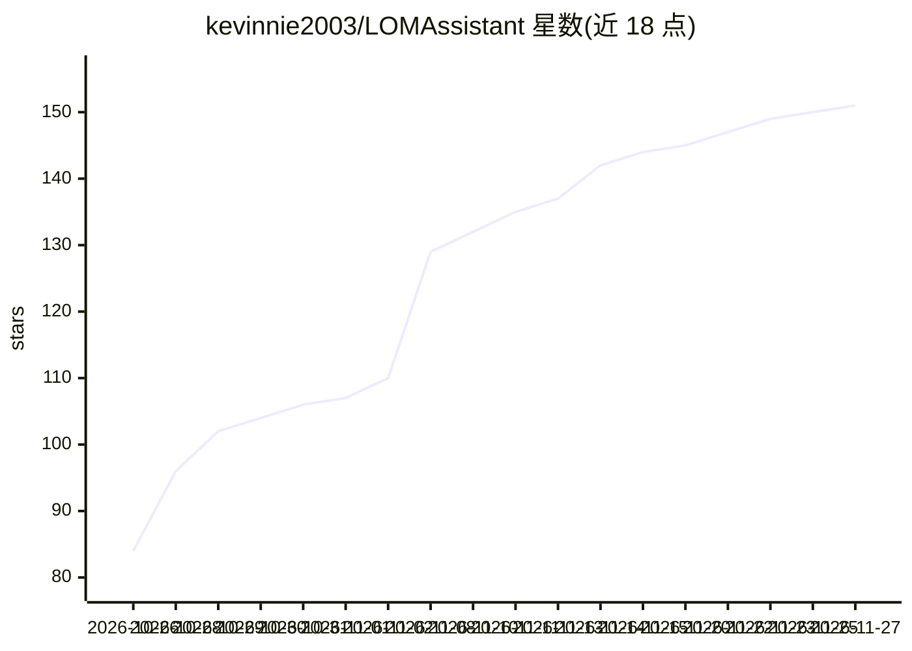

# kevinnie2003/LOMAssistant

⭐ 151 · C# · MIT · 推送 2026-11-26 · [GitHub](https://github.com/kevinnie2003/LOMAssistant) · 个人维护 · 中文 README

**给《活侠传》玩家的全能 Mod：AI 陪玩、剧情辅助与存档增强**

《活侠传》的 BepInEx 6 插件，以自带一键安装器的压缩包形式分发，适配最新版游戏。功能覆盖 AI 陪玩（用自己的 API Key 接入多家大模型，可问剧情攻略或与角色对话，主动陪玩常驻画面）、剧情回顾（路线图、剧情图、剧情跳转、收集进度）、剧情辅助（选项后果、分支自选、随机事件自选）、随时存档、数值面板、战斗与提速优化等，提供四档功能预设。源码开发需 .NET 8 SDK，编译引用游戏程序集。AI 回答可能有误，仅供参考。

## 筛选速览

| 维度 | 判定 | 备注 |
|---|---|---|
| AI 角色 | `ai-enhanced` | 去掉 AI 部分产品仍成立 |
| 许可风险 | `permissive` | MIT |
| 部署形态 | `desktop` | 安装包/桌面程序 |
| 模型依赖 | local-ok | 支持本地模型 |
| 硬件要求 | — | 无带数字的原话,不猜 |
| 安装摩擦 | `medium` | 含编译或系统依赖之一 |
| 成熟度 | — | 结构信号不足 |

## 能力要点

- AI 陪玩：接入 10+ 家模型服务商与本地 Ollama，含攻略助手、角色人设与主动陪玩
- 剧情回顾：路线图、单任务剧情图、剧情跳转与节点存档
- 随时存档不占原版栏位，手动存档扩到 100 个并支持备注
- 一键安装器自动定位游戏目录、处理冲突 Mod，安装器经 SignPath 代码签名

## 适用场景

- 游玩《活侠传》时用 AI 查剧情触发条件、路线与攻略
- 通过分支自选与剧情跳转回溯未读剧情线
- 用随时存档和回退到判定前降低卡关挫败
- 用数值面板调整属性、旗标做测试或补进度

## 场景标签

`聊天机器人` · 领域:对话与助手

## 证据(README 行号)

> L7: 《活侠传》（Legend of Mortal）的 BepInEx 6 插件。适配最新版游戏，并加入 AI 陪玩、剧情回顾、分支自选、修改面板、存档优化等功能。
> L69: 用自己的 API Key 接入大模型，问剧情和攻略，或者和游戏里的人物聊天。支持 DeepSeek、Kimi、通义千问、智谱 GLM、硅基流动、OpenRouter、OpenAI、Claude、Gemini、Vertex AI（用
> L292: 需要 .NET 8 SDK 和装好本 Mod 的游戏目录（编译时引用游戏和 BepInEx 的程序集，仓库里没有游戏文件）。`tools/` 里生成数据的脚本只读本机已安装的游戏，产出 Mod 要用的决斗配置、条件表和随时存档兼

## 星数曲线

2026-10-26 84 → 2026-11-27 151（+67）

---
*卡片 v1 · prompt 1.4 · 生成 2026-11-27 · 置信度 high · 依据 README sha `cd444c2eeba2` · [字段定义](../../DATASET.md)*
