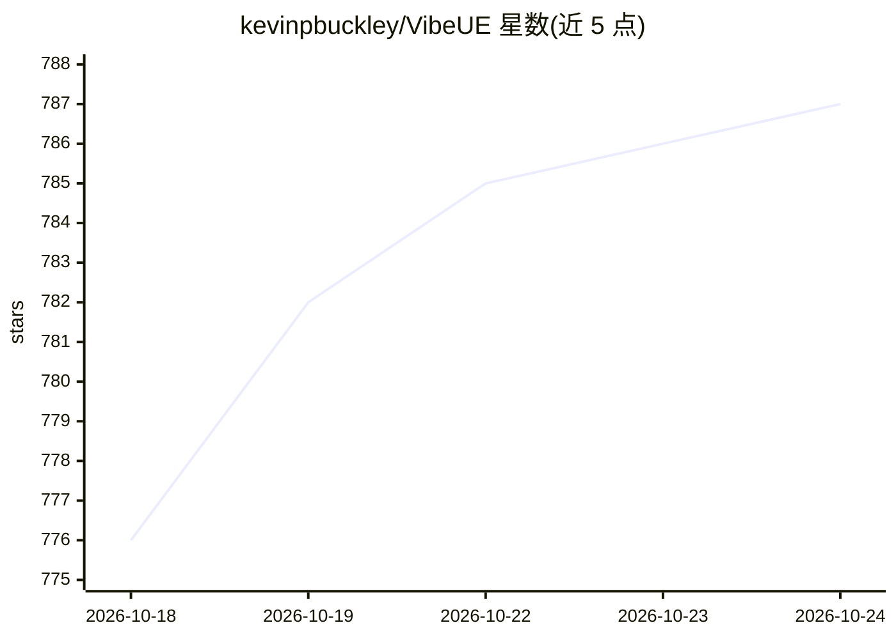

# kevinpbuckley/VibeUE

⭐ 787 · C++ · MIT · 推送 2026-10-22 · [GitHub](https://github.com/kevinpbuckley/VibeUE) · [官网](https://www.vibeue.com) · 个人维护

**扩展 Unreal Engine 5.8+ 原生 MCP 的 AI 编辑器工具集插件**

Unreal Engine 5.8+ 的插件，接入引擎自带的 MCP server 与 ToolsetRegistry，注册地形/植被、动画资产、Niagara、UMG、行为树、性能分析等编辑器能力为 AICallable 工具，并提供约 36 个 markdown skill 包，供任意 MCP 客户端（Claude Code、Cursor、Copilot 等）驱动编辑器。需先启用 Unreal 原生 MCP 插件并启动服务器；通过 git clone 安装并用脚本编译，MCP 端点仅限本机回环。

## 筛选速览

| 维度 | 判定 | 备注 |
|---|---|---|
| AI 角色 | `ai-ecosystem` | LLM/agent 周边工具 |
| 许可风险 | `permissive` | MIT |
| 部署形态 | `None` |  |
| 模型依赖 | — | README 未给出锁定关系 |
| 硬件要求 | — | 无带数字的原话,不猜 |
| 安装摩擦 | `low` | 无编译、无系统依赖或容器化 |
| 成熟度 | — | 结构信号不足 |

## 能力要点

- 在引擎 MCP 端点上注册 Terrain/Animation/Niagara/UMG/性能分析等服务工具
- PerformanceService 提供帧时分析、CPU/GPU 判定与 Unreal Insights trace
- 约 36 个经 AgentSkillToolset 惰性加载的 markdown skill 包
- TransactionService 封装编辑器事务缓冲，支持撤销/回滚 agent 编辑

## 适用场景

- 让 Claude Code/Cursor 等 agent 通过 MCP 操作虚幻编辑器搭建场景与蓝图
- 让 agent 诊断并修复帧率问题（trace 捕获与分析）
- 批量地形生成、动画资产编辑等重复性编辑工作自动化

## 场景标签

 · 领域:游戏开发/AI 工具链

## 证据(README 行号)

> L13: **VibeUE is the MCP Expansion + AI Editor Toolset for Unreal Engine 5.8+.** Unreal 5.8 added a
> L17: `ToolsetRegistry` and `ModelContextProtocol` server, plus rich domain **skills** served through

## 星数曲线

2026-10-18 776 → 2026-10-24 787（+11）

---
*卡片 v1 · prompt 1.4 · 生成 2026-10-21 · 置信度 high · 依据 README sha `7e1964c2c624` · [字段定义](../../DATASET.md)*
