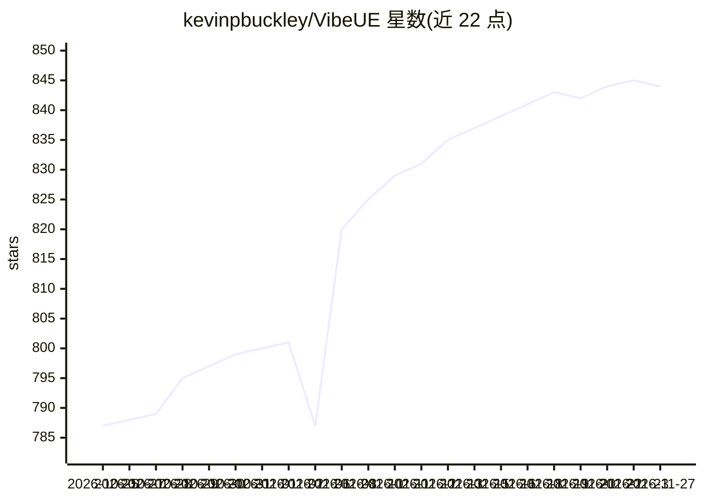

# kevinpbuckley/VibeUE

⭐ 844 · C++ · MIT · 推送 2026-11-26 · [GitHub](https://github.com/kevinpbuckley/VibeUE) · [官网](https://www.vibeue.com) · 个人维护

**为 Unreal Engine 5.8 原生 MCP 扩展编辑器 AI 工具集的插件**

VibeUE 是面向 Unreal Engine 5.8+ 的 MCP 扩展插件，接入引擎内置的 ModelContextProtocol 服务器与 ToolsetRegistry，在引擎原生 AI 工具集之外补充地形/景观、音频（MetaSound/SoundCue）、动画资产、Niagara 特效、UMG 界面、高阶 Blueprint 编排、行为树、性能剖析等领域工具，并以约 36 个 markdown 技能包经 AgentSkill 系统供 agent 懒加载。前提是先启用 Epic 的 Unreal MCP 与 Editor Tools 插件；通过 git clone 到 Plugins 目录并运行构建脚本安装，支持 Claude Code、Cursor、Copilot 等 MCP agent 经回环端点驱动编辑器。

## 筛选速览

| 维度 | 判定 | 备注 |
|---|---|---|
| AI 角色 | `ai-ecosystem` | LLM/agent 周边工具 |
| 许可风险 | `permissive` | MIT |
| 部署形态 | `None` |  |
| 模型依赖 | — | README 未给出锁定关系 |
| 硬件要求 | — | 无带数字的原话,不猜 |
| 安装摩擦 | `low` | 无编译、无系统依赖或容器化 |
| 成熟度 | — | 结构信号不足 |

## 能力要点

- 补充引擎原生工具集未覆盖的地形、音频、动画、Niagara、UMG、行为树等领域工具
- PerformanceService 提供帧计时、CPU/GPU 瓶颈判定、Unreal Insights 捕获与剖析摘要
- 约 36 个 markdown 技能包经 AgentSkillToolset 懒加载，ListSkills 为实时来源
- execute_python_code 可批量执行 unreal.* Python API 并支持 API 自省

## 适用场景

- 让 MCP agent 驱动 UE 编辑器完成地形雕刻、材质与景观自动材质搭建
- 通过 agent 采集 trace 并分析帧率卡顿、定位 CPU/GPU 瓶颈
- 用自然语言/批量脚本编辑蓝图、行为树与动画资产
- 基于 GPS 坐标生成真实世界地形高度图与正射影像

## 场景标签

 · 领域:游戏开发/AI 编辑器工具

## 证据(README 行号)

> L14: built-in MCP server and AI toolsets; VibeUE is an **MCP Expansion** that plugs straight into them and
> L16: Behavior Trees & Blackboards, gameplay tags, input, UVs, **performance/profiling**, and more — registered into the 
> L18: Unreal's native `AgentSkill` system. Any MCP-capable agent (Claude Code, Cursor, Copilot, …) drives

## 星数曲线

2026-10-25 787 → 2026-11-27 844（+57）

---
*卡片 v1 · prompt 1.4 · 生成 2026-11-27 · 置信度 high · 依据 README sha `d8b7d270f073` · [字段定义](../../DATASET.md)*
