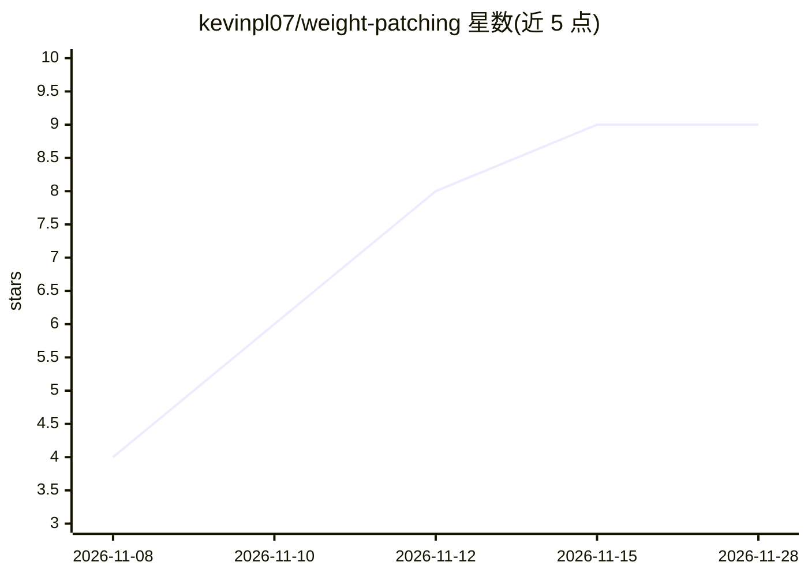

# kevinpl07/weight-patching

⭐ 9 · Python · MIT · 推送 2026-11-06 · [GitHub](https://github.com/kevinpl07/weight-patching) · [官网](https://kevinpl07.github.io/weight-patching/) · 个人维护

**面向研究者的 LLM 权重编辑实验框架与博客配套代码**

博客文章《Weight-space programming, tested on real bugs》的配套仓库，含两部分：patchkit/ 是权重补丁小框架，对每个可观测失败提供五种修复方式的统一对比（无操作、系统提示、单神经元权重编辑、随机编辑对照、LoRA 微调），共用留出数据与防护检查；archive/ 存放早期实验（grokking、RL、预训练、ViT、Whisper 等）的记录与报告。通过 pip 安装依赖后以 python -m patchkit.run 驱动流程，支持 --model 换用任意 HF 模型；实验约需一块 24 GB GPU 运行 1 小时。模型权重本身不随仓库分发。

## 筛选速览

| 维度 | 判定 | 备注 |
|---|---|---|
| AI 角色 | `ai-ecosystem` | LLM/agent 周边工具 |
| 许可风险 | `permissive` | MIT |
| 部署形态 | `library` | 以包/库形式分发 |
| 模型依赖 | — | README 未给出锁定关系 |
| 硬件要求 | — | 无带数字的原话,不猜 |
| 安装摩擦 | `low` | 无编译、无系统依赖或容器化 |
| 成熟度 | — | 结构信号不足 |

## 能力要点

- 单神经元门控编辑：只改动约 3×d_model 个权重，无需训练
- 五种修复方式的统一对比协议与留出数据评估
- 覆盖编造人名、agent 注入、口头禅、静音转录、语言混杂五类任务
- --model 参数支持替换为任意 Hugging Face 模型

## 适用场景

- 复现或扩展权重编辑 vs LoRA 的对比实验
- 为新的模型失败模式按协议添加一个任务文件
- 研究微调后权重编辑的持久性

## 场景标签

`微调` · 领域:训练与推理

## 证据(README 行号)

> L8: 1. **`patchkit/`**, a small framework for "weight patches". It covers:
> L42: python -m patchkit.run all entity          # data → base → signal → gate + random → LoRA → eval (≈1 h on one 24 GB 

## 星数曲线

2026-11-08 4 → 2026-11-28 9（+5）

---
*卡片 v1 · prompt 1.4 · 生成 2026-11-20 · 置信度 mid · 依据 README sha `29bc6ccefb4a` · [字段定义](../../DATASET.md)*
