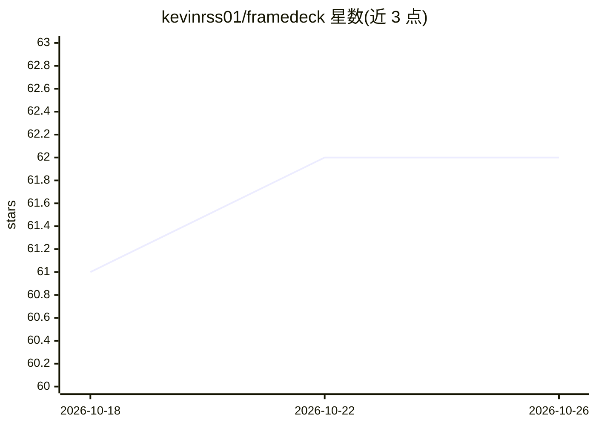

# kevinrss01/framedeck

⭐ 62 · TypeScript · 推送 2026-05-25 · [GitHub](https://github.com/kevinrss01/framedeck) · [官网](https://framedeck.ai) · 个人维护

**自然语言驱动的 AI 视频编辑器：对话生成时间线编辑与字幕**

Turborepo 单体仓库构成的视频编辑软件：Next.js 前端承载编辑器、聊天助手与渲染客户端，NestJS 服务器提供类型化 API 与 AI 工具编排，Rust/Axum 服务用 FFmpeg 做音频提取以供转录。上传走 S3 分片直传，后台调用 ElevenLabs Scribe v2 转录与 TwelveLabs 视频分析，聊天助手经服务端 AI Gateway 流式输出工具事件并回写时间线。运行需 Node.js、PNPM、Rust 工具链、FFmpeg、AWS S3 凭证及 OpenAI/ElevenLabs/TwelveLabs/Deepgram 等多家 API key。

## 筛选速览

| 维度 | 判定 | 备注 |
|---|---|---|
| AI 角色 | `ai-native` | 本体是模型或模型工具 |
| 许可风险 | `none` | — |
| 部署形态 | `library` | 以包/库形式分发 |
| 模型依赖 | — | README 未给出锁定关系 |
| 硬件要求 | — | 无带数字的原话,不猜 |
| 安装摩擦 | `medium` | 含编译或系统依赖之一 |
| 成熟度 | — | 结构信号不足 |

## 能力要点

- 自然语言提示转时间线编辑：去静音、字幕、素材分析、配音准备
- S3 分片直传 + 后台 ElevenLabs Scribe v2 转录与 TwelveLabs 视频分析
- 聊天助手经服务端 AI Gateway 调用工具，实时事件回写编辑器时间线
- Rust/Axum + FFmpeg 的音频提取服务

## 适用场景

- 上传素材后用对话让 AI 完成剪辑并渲染成片
- 自动去除静音片段并生成字幕
- 对素材做 AI 视频分析辅助剪辑决策

## 场景标签

`图像视频处理` `语音识别` · 领域:感知与多模态

## 证据(README 行号)

> L5: AI video editing software that turns natural language prompts into timeline edits: remove silences, add captions, an
> L45: 5. Server starts ElevenLabs Scribe v2 transcription and TwelveLabs video analysis in the background.

## 星数曲线

2026-10-18 61 → 2026-10-26 62（+1）

---
*卡片 v1 · prompt 1.4 · 生成 2026-10-24 · 置信度 high · 依据 README sha `1b1ab3a86238` · [字段定义](../../DATASET.md)*
