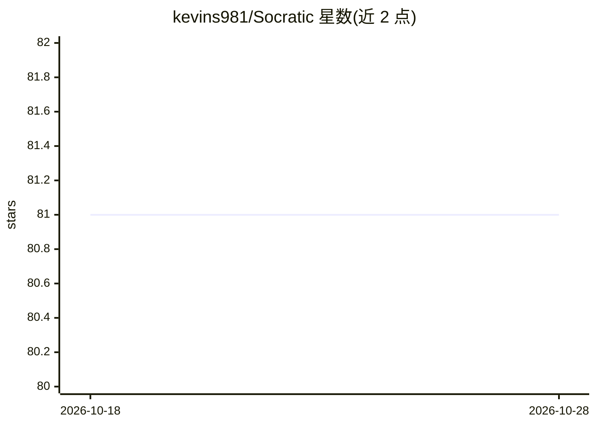

# kevins981/Socratic

⭐ 81 · JavaScript · Apache-2.0 · 推送 2026-01-13 · [GitHub](https://github.com/kevins981/Socratic) · 个人维护

**让专家通过人机交互构建垂直领域知识库的 KnowledgeOps 平台**

面向构建垂直领域 agent 的团队的 KnowledgeOps 平台：指向既有领域文档，通过与人类专家交互提问、识别歧义并请求澄清，将隐性领域知识蒸馏为模块化纯文本知识单元，形成可审计的知识库；每次变更可检视、diff 并显式批准。底层由 OpenAI Codex 作为终端 agent 读取分析源文档（只读沙箱模式），支持 OpenAI、ChatGPT 订阅、OpenRouter 及任何 OpenAI 兼容 API 的模型；本地部署安装需 git clone 源码并配置 npm/Codex，要求 Linux 内核 >= 5.15，输出全部本地存储。模型质量方面小模型易出现工具调用不稳定。

## 筛选速览

| 维度 | 判定 | 备注 |
|---|---|---|
| AI 角色 | `ai-ecosystem` | LLM/agent 周边工具 |
| 许可风险 | `permissive` | Apache-2.0 |
| 部署形态 | `library` | 以包/库形式分发 |
| 模型依赖 | locked-api |  |
| 硬件要求 | — | 无带数字的原话,不猜 |
| 安装摩擦 | `low` | 无编译、无系统依赖或容器化 |
| 成熟度 | — | 结构信号不足 |

## 能力要点

- 人机交互式知识蒸馏：提问、识别歧义、请求澄清
- 生成模块化纯文本知识单元，可审计、可被下游 agent 直接使用
- 以 Codex 为终端 agent 只读沙箱读取代码/规格/文档
- 支持 OpenAI/ChatGPT 订阅/OpenRouter 及 OpenAI 兼容本地模型

## 适用场景

- 为垂直领域 agent 构建可信的知识库替代文档堆砌式 RAG
- 专家将隐性领域规则提炼为结构化知识条目
- 在本地审计和管理 agent 实际掌握的知识

## 场景标签

`知识库管理` · 领域:知识与检索

## 证据(README 行号)

> L3: Socratic is a KnowledgeOps platform that helps teams build expert-level knowledge base for vertical, domain-specific
> L35:  It generates clean, modular, plain-text knowledge units - fully auditable and directly usable by downstream agents
> L39: The result is a **structured, trustworthy knowledge base**, not an opaque embedding index giving you control over w

## 星数曲线

2026-10-18 81 → 2026-10-28 81（+0）

---
*卡片 v1 · prompt 1.4 · 生成 2026-10-24 · 置信度 high · 依据 README sha `1e8abf858844` · [字段定义](../../DATASET.md)*
