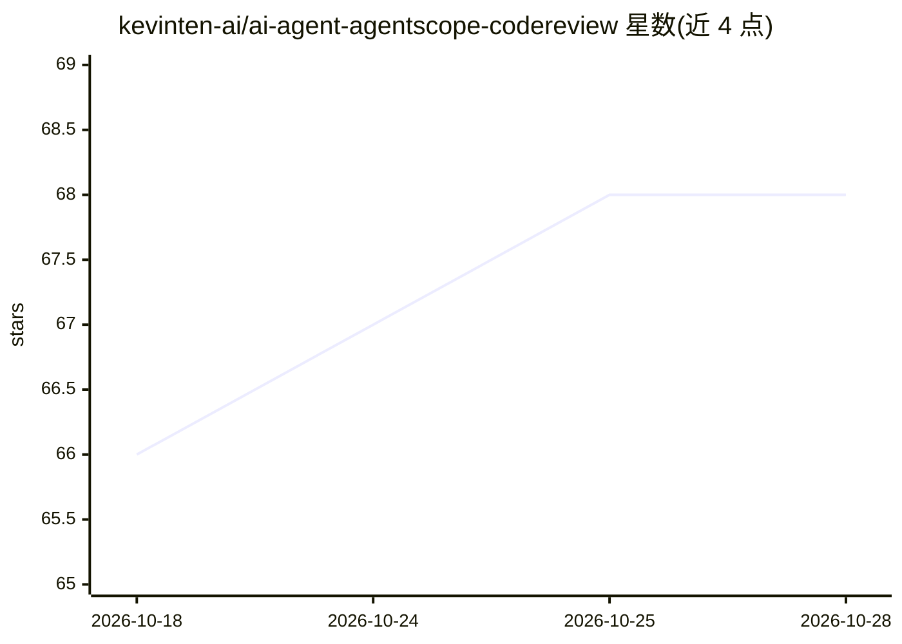

# kevinten-ai/ai-agent-agentscope-codereview

⭐ 69 · Java · 推送 2026-06-28 · [GitHub](https://github.com/kevinten-ai/ai-agent-agentscope-codereview) · [官网](https://java.agentscope.io) · 个人维护 · 中文 README

**基于 AgentScope Java SDK 的代码审查 Agent 项目与框架学习教程**

以 Spring Boot + AgentScope Java SDK 实现的 AI 代码审查 Agent：ReAct 循环驱动，注册 6 个审查工具（代码分析、安全扫描、性能分析等），默认配置 DashScope/Qwen 模型并启用思维模式。项目同时作为 AgentScope 框架教程，系统讲解 Agent/Message/Tool/Memory/Pipeline 概念、Hook 生命周期、多 Agent 协作模式与进阶学习路线。运行需 JDK 21+、Maven 3.6+ 与 DashScope API Key，从源码克隆构建。

## 筛选速览

| 维度 | 判定 | 备注 |
|---|---|---|
| AI 角色 | `ai-native` | 本体是模型或模型工具 |
| 许可风险 | `none` | — |
| 部署形态 | `None` |  |
| 模型依赖 | local-ok | 支持本地模型 |
| 硬件要求 | — | 无带数字的原话,不猜 |
| 安装摩擦 | `medium` | 含编译或系统依赖之一 |
| 成熟度 | — | 结构信号不足 |

## 能力要点

- ReAct 模式代码审查 Agent，含 6 个注解驱动的审查工具
- 覆盖 Agent/Tool/Memory/Pipeline 与多 Agent 协作（Agent-as-Tool、Pipeline、MsgHub、A2A）的框架教程
- Spring Boot 集成示例与 DashScope Qwen 思维模式配置
- 提供工具开发最佳实践与四级学习路线图

## 适用场景

- 让 AI Agent 对 Java 代码做安全、性能与风格审查并生成报告
- 学习 AgentScope Java SDK 的 ReAct、工具系统与多 Agent 编排
- 参考 Spring Boot 与 Agent 框架的标准集成方式

## 场景标签

`代码审查` `教程课程` · 领域:编码与开发

## 证据(README 行号)

> L5:  基于 AgentScope Java SDK 实现的智能代码审查 AI Agent 项目，同时作为 AgentScope 框架的学习教程。
> L212: ReAct（Reasoning + Acting）是 AgentScope 的核心 Agent 推理范式，也是本项目使用的模式。

## 星数曲线

2026-10-18 66 → 2026-10-28 68（+2）

---
*卡片 v1 · prompt 1.4 · 生成 2026-10-24 · 置信度 mid · 依据 README sha `78fde9aa0249` · [字段定义](../../DATASET.md)*
