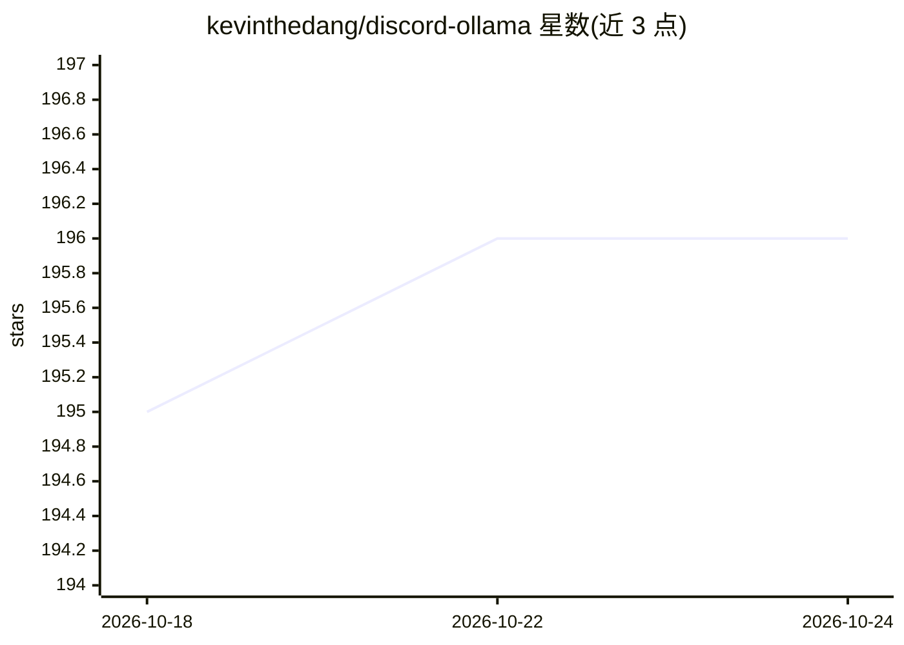

# kevinthedang/discord-ollama

⭐ 196 · TypeScript · CC-BY-4.0 · 推送 2026-10-22 · [GitHub](https://github.com/kevinthedang/discord-ollama) · 个人维护

**连接本地 Ollama 模型的 Discord 聊天机器人**

基于 discord.js 的 Discord 机器人，通过 Ollama API 与本地部署的大语言模型对话。功能包括模型管理、流式响应、对话历史、私密线程与可配置的服务器控制。模型与数据保留在本地 Ollama 中。运行需 Node.js（lts/jod 以上）、npm 10.9.0 以上，配置 .env 中的 bot token 与 LLM 端点；提供 Docker 部署文档，README 提及 Nvidia GPU 为推荐配置。

## 筛选速览

| 维度 | 判定 | 备注 |
|---|---|---|
| AI 角色 | `ai-ecosystem` | LLM/agent 周边工具 |
| 许可风险 | `viral` | CC-BY-4.0 |
| 部署形态 | `None` |  |
| 模型依赖 | local-ok | 支持本地模型 |
| 硬件要求 | — | 无带数字的原话,不猜 |
| 安装摩擦 | `low` | 无编译、无系统依赖或容器化 |
| 成熟度 | `idea` | |

## 能力要点

- 通过 Ollama API 与本地大语言模型对话
- 支持模型管理、流式响应、对话历史与私密线程
- 提供 Docker 部署指南（服务器与本地）
- 可配置服务器控制与 LLM 端点（LLM_ENDPOINT/LLM_PORT）

## 适用场景

- 在 Discord 服务器里与本地托管的开源模型对话
- 用私密线程保留与 bot 的对话历史
- 在自有基础设施上运行 AI 助手并控制模型与数据

## 场景标签

`聊天机器人` · 领域:对话与助手

## 证据(README 行号)

> L10: Discord Ollama is a Discord bot that lets users interact with locally hosted
> L13: The bot supports model management, streamed responses, conversation history,
> L28:  * The LLM server is configured with `LLM_ENDPOINT` / `LLM_PORT` (`OLLAMA_IP` / `OLLAMA_PORT` still work as depreca

## 星数曲线

2026-10-18 195 → 2026-10-24 196（+1）

---
*卡片 v1 · prompt 1.4 · 生成 2026-10-22 · 置信度 high · 依据 README sha `3339d92e1fd7` · [字段定义](../../DATASET.md)*
