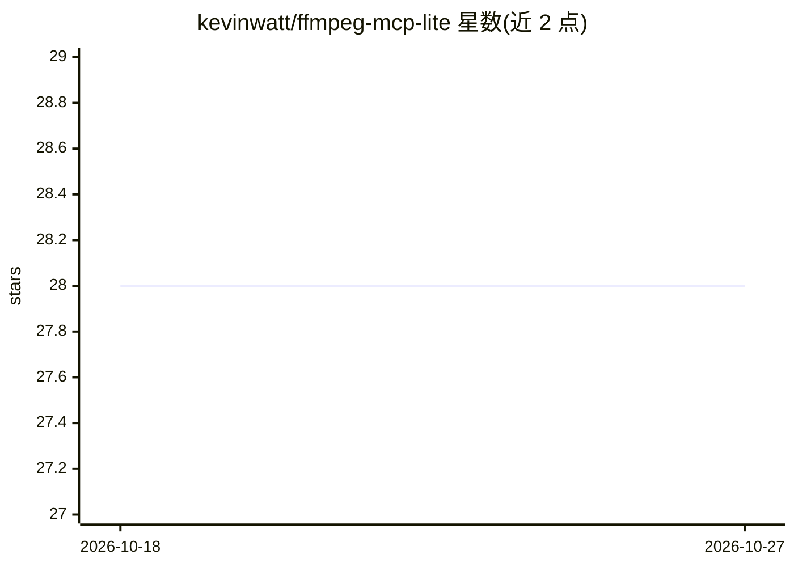

# kevinwatt/ffmpeg-mcp-lite

⭐ 28 · Python · MIT · 推送 2026-05-08 · [GitHub](https://github.com/kevinwatt/ffmpeg-mcp-lite) · [官网](https://pypi.org/project/ffmpeg-mcp-lite/) · 个人维护

**让 AI 客户端通过自然语言调用 FFmpeg 的 MCP 服务器**

基于 FastMCP 与 asyncio 构建的 MCP 服务器，把 FFmpeg/FFprobe 封装为 8 个以 ffmpeg_ 前缀命名的工具：获取媒体元数据、格式转换、压缩、裁剪、合并、提取音频与帧、烧录 SRT/ASS/VTT 字幕。面向 Claude Code、Claude Desktop、Cursor、VS Code/Copilot、Dive、Windsurf 等 MCP 客户端用户，通过 JSON 配置或 CLI 命令接入。需系统预装 FFmpeg，支持 FFMPEG_PATH 等环境变量自定义路径与输出目录，跨 Windows/macOS/Linux 运行。

## 筛选速览

| 维度 | 判定 | 备注 |
|---|---|---|
| AI 角色 | `ai-ecosystem` | LLM/agent 周边工具 |
| 许可风险 | `permissive` | MIT |
| 部署形态 | `library` | 以包/库形式分发 |
| 模型依赖 | — | README 未给出锁定关系 |
| 硬件要求 | — | 无带数字的原话,不猜 |
| 安装摩擦 | `medium` | 含编译或系统依赖之一 |
| 成熟度 | — | 结构信号不足 |

## 能力要点

- 8 个 MCP 工具覆盖转换/压缩/裁剪/合并/音频帧提取/字幕烧录
- 异步子进程执行 FFmpeg，非阻塞
- 输出目录、二进制路径可通过环境变量配置
- 跨平台支持（Windows/macOS/Linux），含 32 个 pytest 测试用例

## 适用场景

- 在 Claude/Cursor 等 MCP 客户端中用自然语言处理视频音频
- 批量转换、压缩或裁剪视频而无需手写 FFmpeg 命令
- 为视频烧录字幕、提取音轨或抽帧

## 场景标签

`图像视频处理` · 领域:感知与多模态

## 证据(README 行号)

> L9: Integrate FFmpeg with Claude, Dive, and other MCP-compatible AI systems. Convert, compress, trim videos, extract aud
> L317: - **FastMCP** - MCP Python framework

## 星数曲线

2026-10-18 28 → 2026-10-27 28（+0）

---
*卡片 v1 · prompt 1.4 · 生成 2026-10-26 · 置信度 high · 依据 README sha `5296842b4e86` · [字段定义](../../DATASET.md)*
