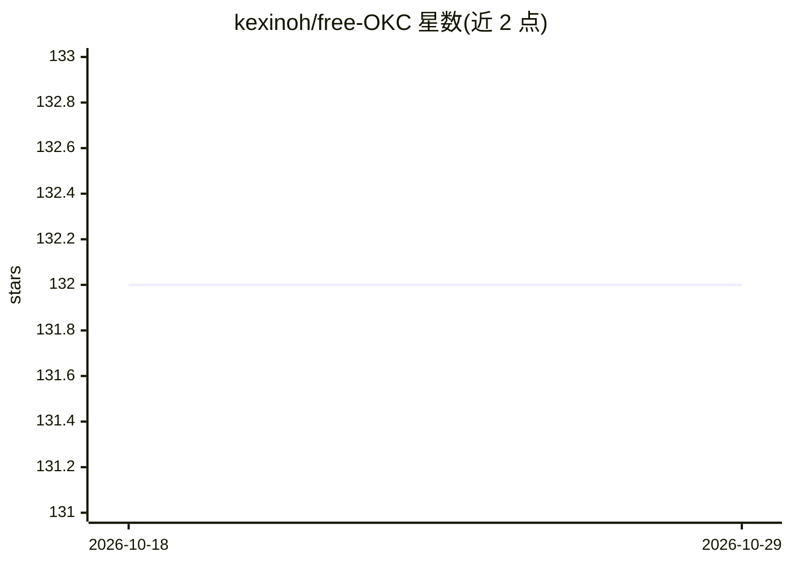

# kexinoh/free-OKC

⭐ 132 · Python · MIT · 推送 2026-01-03 · [GitHub](https://github.com/kexinoh/free-OKC) · 个人维护 · 中文 README

**自托管复现 Moonshot OK Computer agent 的虚拟机编排层**

开源的虚拟机容器编排层，复刻 Moonshot AI "OK Computer" agent 的系统提示词与工具契约：打包规范文件、工具清单及文件系统访问、代码执行、网页浏览等核心工具的 Python 参考实现，供团队自托管兼容的 agent 工作流。附带 FastAPI Web 控制面板与跨平台 Electron 桌面客户端（macOS/Windows/Linux 安装包），支持配置对话、图像生成、TTS、音效合成与 ASR 五类模型端点；会话工作区随机虚拟挂载并基于 Git 做检查点，会话元数据存于 MySQL 兼容数据库。

## 筛选速览

| 维度 | 判定 | 备注 |
|---|---|---|
| AI 角色 | `ai-ecosystem` | LLM/agent 周边工具 |
| 许可风险 | `permissive` | MIT |
| 部署形态 | `library` | 以包/库形式分发 |
| 模型依赖 | — | README 未给出锁定关系 |
| 硬件要求 | — | 无带数字的原话,不猜 |
| 安装摩擦 | `low` | 无编译、无系统依赖或容器化 |
| 成熟度 | — | 结构信号不足 |

## 能力要点

- 复刻 OK Computer 的系统提示词与工具规范，含核心工具 Python 参考实现
- FastAPI Web 控制面板 + Electron 桌面客户端（零配置、跨平台安装包）
- 支持配置 Chat/图像生成/TTS/音效合成/ASR 五类模型端点
- Git 工作区检查点，可列出快照并回滚到之前的轮次

## 适用场景

- 团队自托管兼容 OK Computer 的 agent 工作流
- 通过桌面客户端或 Web 面板与自托管 agent 对话
- 以 Python API 将 agent VM 嵌入自有系统，注册自定义工具

## 场景标签

`Agent 框架` · 领域:Agent 开发

## 证据(README 行号)

> L7: **OKCVM** is an open-source virtual machine container orchestration layer that faithfully reproduces the system prom
> L15: - **🌐 Web UI Included**: Ships with a FastAPI-based web service and control panel, offering an out-of-the-box chat 
> L18: - **🔌 Effortless Integration**: Provides a clean Python API, making it simple to integrate OKCVM into your existing

## 星数曲线

2026-10-18 132 → 2026-10-29 132（+0）

---
*卡片 v1 · prompt 1.4 · 生成 2026-10-23 · 置信度 high · 依据 README sha `8d36ef66ad8a` · [字段定义](../../DATASET.md)*
