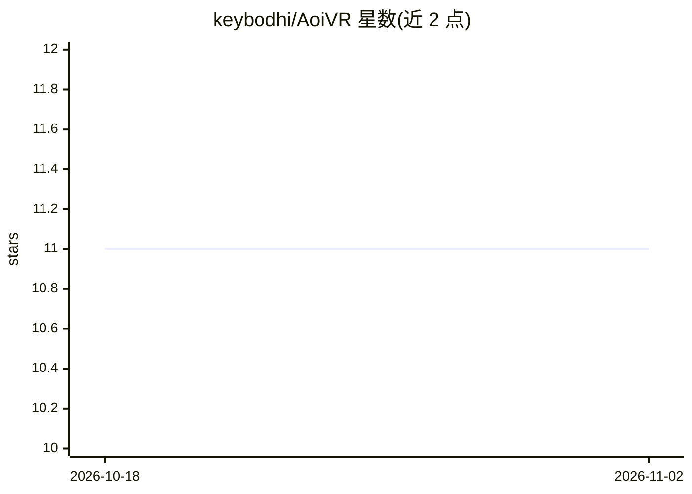

# keybodhi/AoiVR

⭐ 11 · C# · MIT · 推送 2026-09-03 · [GitHub](https://github.com/keybodhi/AoiVR) · 个人维护 · 中文 README

**住在 SteamVR 控制器上的 VR AI 语音助手**

以 OpenVR overlay 形式附着在右手控制器的全息手板面板，由本地原生 C++ agent（aoi_agent.dll，C++20）驱动：支持 OpenAI 兼容 LLM 对话（针对 opencode zen/go 网关优化 prompt 缓存与流式推理）、流式 TTS、按需 VR 截图、系统音频转写与实时同声传译，以及应用音量、VR 亮度等系统控制。Unity IL2CPP 客户端 + 进程内 agent 循环。提供 Releases 预编译包（含免 key 演示模式），也可从源码用 MSVC/CMake 与 Unity 6000.5 构建。

## 筛选速览

| 维度 | 判定 | 备注 |
|---|---|---|
| AI 角色 | `ai-native` | 本体是模型或模型工具 |
| 许可风险 | `permissive` | MIT |
| 部署形态 | `desktop` | 安装包/桌面程序 |
| 模型依赖 | — | README 未给出锁定关系 |
| 硬件要求 | — | 无带数字的原话,不猜 |
| 安装摩擦 | `medium` | 含编译或系统依赖之一 |
| 成熟度 | — | 结构信号不足 |

## 能力要点

- OpenVR 手板面板：激光/射线输入、桌面镜像、-desktop 无头显模式
- 进程内 C++ agent 循环（aoi_agent.dll），不阻塞 Unity 渲染线程
- VR 截图环境感知与系统音频实时同声传译
- -demo 模式无需任何 API key 即可体验界面

## 适用场景

- 在 VR 中通过语音与 AI 助手对话并让它查看我的 VR 空间
- 游戏中实时翻译系统音频实现同声传译
- 免头显桌面模式预览面板或录制演示

## 场景标签

`语音 Agent` · 领域:对话与助手

## 证据(README 行号)

> L5: 全息手板面板附着在你的控制器上——由本地原生 C++ agent 驱动（内置 LLM 客户端、
> L15: |🎙️ **语音对话**|LLM 对话（OpenAI 兼容，针对 opencode zen/go 网关优化：prompt 缓存、流式推理、用量统计）+ 流式 TTS|
> L18: |🌐 **同声传译**|实时翻译系统音频|

## 星数曲线

2026-10-18 11 → 2026-11-02 11（+0）

---
*卡片 v1 · prompt 1.4 · 生成 2026-11-02 · 置信度 high · 依据 README sha `5fe5b241993d` · [字段定义](../../DATASET.md)*
