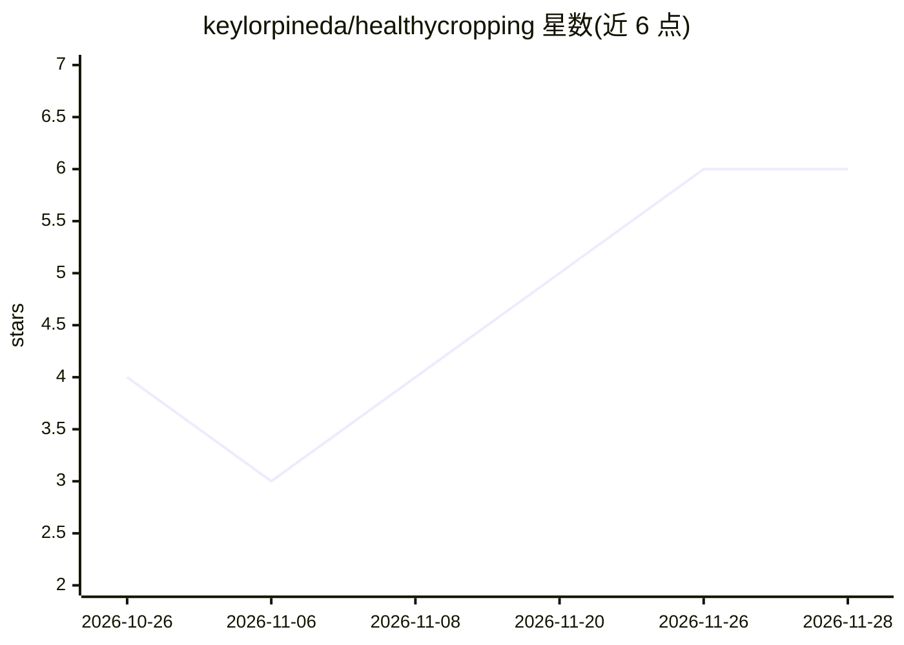

# keylorpineda/healthycropping

⭐ 6 · TypeScript · MIT · 推送 2026-11-20 · [GitHub](https://github.com/keylorpineda/healthycropping) · 个人维护

**咖啡/可可/香蕉病害离线拍照诊断 Android 应用**

面向哥斯达黎加小农与中型种植户的离线优先 Android 应用：对咖啡、可可、香蕉各部署一个 float16 TFLite 模型（MobileNetV3-Large，约 6.1 MB/个），手机端拍照完成推理，共 12 个健康/病害类别，诊断无需网络；扫描、农场与地块数据存于 SQLite。联网时可选账号经 FastAPI 后端同步，并由 Gemini RAG 引用官方手册（ICAFE、CATIE、CORBANA）生成带出处的处置建议。当前无可安装 APK，需从源码构建；明确定位为决策支持，不替代农艺师。

## 筛选速览

| 维度 | 判定 | 备注 |
|---|---|---|
| AI 角色 | `ai-native` | 本体是模型或模型工具 |
| 许可风险 | `permissive` | MIT |
| 部署形态 | `library` | 以包/库形式分发 |
| 模型依赖 | — | README 未给出锁定关系 |
| 硬件要求 | — | 无带数字的原话,不猜 |
| 安装摩擦 | `low` | 无编译、无系统依赖或容器化 |
| 成熟度 | `idea` | |

## 能力要点

- 三个作物各一个 TFLite 模型，共 12 类，诊断时 0 次网络调用
- 置信度低于校准阈值时要求重拍而非输出猜测
- Gemini RAG 建议引用官方手册章节，可离线回读
- 数据经 FastAPI 后端同步，手机不直连 Firestore

## 适用场景

- 无信号山区地块现场诊断咖啡叶锈病等病害
- 离线记录农场、地块与扫描历史
- 联网后获取带手册出处的处置建议

## 场景标签

`RAG` · 领域:知识与检索

## 证据(README 行号)

> L21: **HealthyCropping** (`com.keylorpineda.healthycropping`) is an open-source, non-commercial, offline-first Android a
> L46: 3. **On-device inference** with `react-native-fast-tflite`.
> L47: 4. **Verdict**: if confidence is under the crop's calibrated threshold, the app asks for a new photo instead of gue

## 星数曲线

2026-10-26 4 → 2026-11-28 6（+2）

---
*卡片 v1 · prompt 1.4 · 生成 2026-11-21 · 置信度 mid · 依据 README sha `7374e89ba5e1` · [字段定义](../../DATASET.md)*
