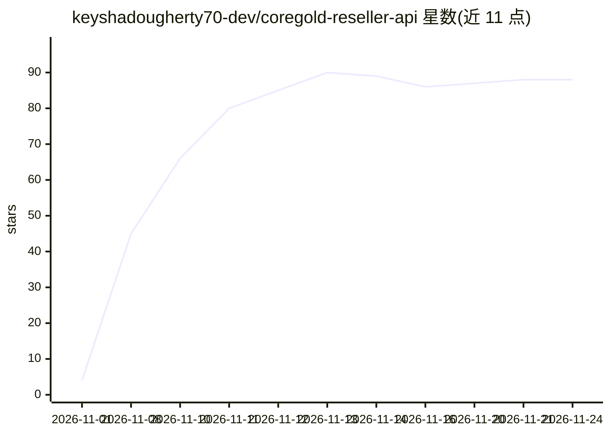

# keyshadougherty70-dev/coregold-reseller-api

⭐ 93 · 推送 2026-10-31 · [GitHub](https://github.com/keyshadougherty70-dev/coregold-reseller-api) · [官网](https://app.coregold.io/signup?invite_code=ADvlj9b) · 组织维护 · 中文 README

**面向号商与 API 中继站的批量虚拟发卡服务推广页**

CoreGold 发卡服务的宣传 README，目标用户为海外账号批发商（ChatGPT/Claude/Cursor 成品号）与 AI API 中继分发平台运营者。宣称提供商用卡段批量开卡、USDT 充值、单卡额度锁定、废卡余额退回母账户等功能，并附注册链接。内容为营销文案，未包含代码仓库结构、安装运行方式或 API 接入文档等技术事实。

## 筛选速览

| 维度 | 判定 | 备注 |
|---|---|---|
| AI 角色 | `ai-enhanced` | 去掉 AI 部分产品仍成立 |
| 许可风险 | `none` | — |
| 部署形态 | `None` |  |
| 模型依赖 | — | README 未给出锁定关系 |
| 硬件要求 | — | 无带数字的原话,不猜 |
| 安装摩擦 | `low` | 无编译、无系统依赖或容器化 |
| 成熟度 | — | 结构信号不足 |

## 能力要点

- 宣称支持后台自主批量下卡并生成卡号/CVV/AVS 地址
- 宣称支持 USDT 实时充值与废卡余额回流母账户
- 面向 AI 账号批发与 API 中继分发场景

## 适用场景

- 号商为批量注册 AI 账号获取虚拟卡
- API 中继站为多账号绑定管理付费卡片

## 场景标签

 · 领域:支付/虚拟卡服务

## 证据(README 行号)

> L2: ⚡ 别找二手卡贩子了！号商与 API 中继站专属批量供卡底座
> L5: > **直戳行业痛点**：做海外账号批发（ChatGPT / Claude / Cursor 成品号）或者自己搭 AI API 中继分发平台，最怕供货卡商层层抽成、卡片动不动批量暴毙。遇到坏卡找上游售后扯皮几天，压在里面的资金全成死

## 星数曲线

2026-11-01 4 → 2026-11-24 88（+84）

---
*卡片 v1 · prompt 1.4 · 生成 2026-11-17 · 置信度 low · 依据 README sha `3f3ddb66524b` · [字段定义](../../DATASET.md)*
