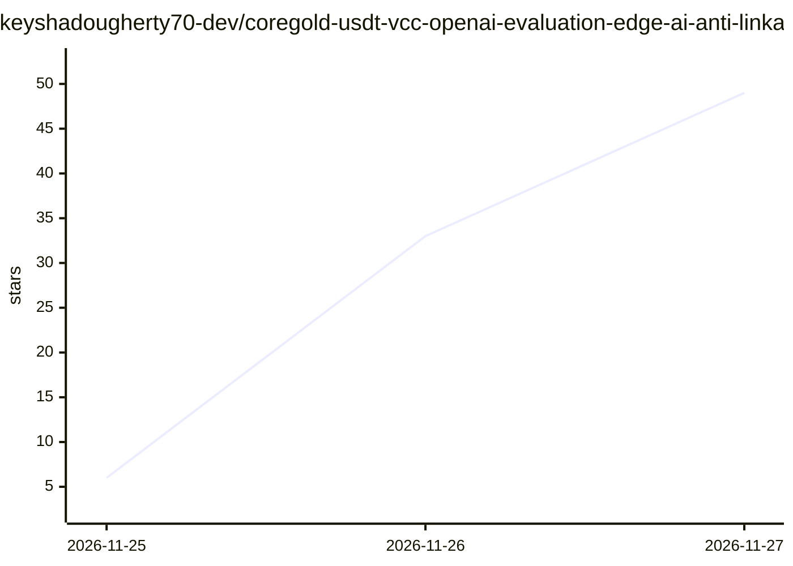

# keyshadougherty70-dev/coregold-usdt-vcc-openai-evaluation-edge-ai-anti-linkage-guide

⭐ 49 · 推送 2026-11-23 · [GitHub](https://github.com/keyshadougherty70-dev/coregold-usdt-vcc-openai-evaluation-edge-ai-anti-linkage-guide) · [官网](https://app.coregold.io/signup?invite_code=ADvlj9b) · 个人维护 · 中文 README

**面向多账号测试开发者的 CoreGold 虚拟卡开卡与防关联指南**

以 CoreGold 虚拟卡服务为主题的操作指南，内容为在多个测试账号间避免支付层关联的流程说明：解释银行卡指纹机制、账单地址（AVS）填写规则、Apple Pay/Google Pay 绑定步骤，并给出 USDT（TRC20）充值、选择套餐与卡段、卡片管理（充值/冻结/提现）的操作路径。文中提及的模型评测框架与端侧模型仅作为背景叙述，未提供任何代码、工具或安装方式。

## 筛选速览

| 维度 | 判定 | 备注 |
|---|---|---|
| AI 角色 | `ai-enhanced` | 去掉 AI 部分产品仍成立 |
| 许可风险 | `none` | — |
| 部署形态 | `None` |  |
| 模型依赖 | — | README 未给出锁定关系 |
| 硬件要求 | — | 无带数字的原话,不猜 |
| 安装摩擦 | `low` | 无编译、无系统依赖或容器化 |
| 成熟度 | — | 结构信号不足 |

## 能力要点

- 说明同一张卡绑定多个账号的支付层关联风险与规避方法
- 提供 USDT（TRC20）充值到开卡到绑定数字钱包的完整流程
- 支持为每张卡独立生成或手动填写账单信息（AVS）
- 卡片管理支持充值、提现与冻结，提供个人计划与团队计划

## 适用场景

- 为多个测试账号分别开设独立虚拟卡以避免支付关联
- 在支持数字钱包的测试场景中用 Apple Pay/Google Pay 结账
- 为自动化测试脚本设置预算上限并事后冻结卡片

## 场景标签

 · 领域:支付/虚拟卡服务指南

## 证据(README 行号)

> L1: # coregold-usdt-vcc-openai-evaluation-edge-ai-anti-linkage-guide
> L13: **正确做法**：在 CoreGold 按需为每个独立测试账号开一张专属虚拟卡，彻底切断支付层面的关联。
> L34: #### 第二步：使用 USDT（TRC20）充值钱包

## 星数曲线

2026-11-25 6 → 2026-11-27 49（+43）

---
*卡片 v1 · prompt 1.4 · 生成 2026-11-24 · 置信度 high · 依据 README sha `c6a94241a047` · [字段定义](../../DATASET.md)*
