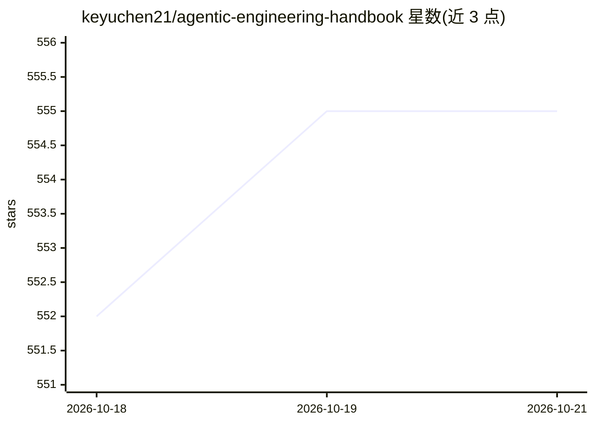

# keyuchen21/agentic-engineering-handbook

⭐ 561 · Python · MIT · 推送 2026-10-20 · [GitHub](https://github.com/keyuchen21/agentic-engineering-handbook) · 个人维护

**Agentic 工程学习路线图：218 条精选资源的结构化手册**

面向想掌握生产级 AI agent 系统的开发者的学习路线图仓库，将散落在 OpenAI/Anthropic/Google 博客、SDK 文档与论文中的知识整合为 218 条精选资源。内容按 Phase 0–7 组织：从零实现 agent 循环（含可运行的 v0–v4 Python 实验代码）、agent 基础心智模型、MCP 与工具生态、上下文/记忆/技能，到评测与生产实践，每个阶段附 Read First/Then Read 阅读清单与 Build Exercise 构建练习。MIT 许可，纯文档加少量示例代码。

## 筛选速览

| 维度 | 判定 | 备注 |
|---|---|---|
| AI 角色 | `ai-knowledge` | 知识聚合/清单类 |
| 许可风险 | `permissive` | MIT |
| 部署形态 | `None` |  |
| 模型依赖 | — | README 未给出锁定关系 |
| 硬件要求 | — | 无带数字的原话,不猜 |
| 安装摩擦 | `low` | 无编译、无系统依赖或容器化 |
| 成熟度 | — | 结构信号不足 |

## 能力要点

- 218 条精选资源按 Phase 0–7 结构化组织
- Phase 0 提供从 Bash agent 到子代理机制的 v0–v4 可运行实验代码
- 每阶段附阅读清单（标注厂商来源）与 Build Exercise 构建练习
- 覆盖 MCP、上下文工程、评测与生产实践等主题

## 适用场景

- 按阶段系统学习 agent 工程从入门到生产部署
- 已有 LLM 应用经验者补充 agent 循环、工具调用与评测知识
- 查找 OpenAI/Anthropic/Google 官方 agent 文档与最佳实践的索引

## 场景标签

`教程课程` `精选清单` · 领域:学习与行业

## 证据(README 行号)

> L12: The AI industry has entered the **Agentic Era**. Building production-grade AI systems now requires mastering agents
> L14: This repository consolidates **218 curated resources** into one structured learning roadmap.
> L40: ## Learning Roadmap

## 星数曲线

2026-10-18 552 → 2026-10-21 555（+3）

---
*卡片 v1 · prompt 1.4 · 生成 2026-10-22 · 置信度 high · 依据 README sha `f98a19f50eac` · [字段定义](../../DATASET.md)*
