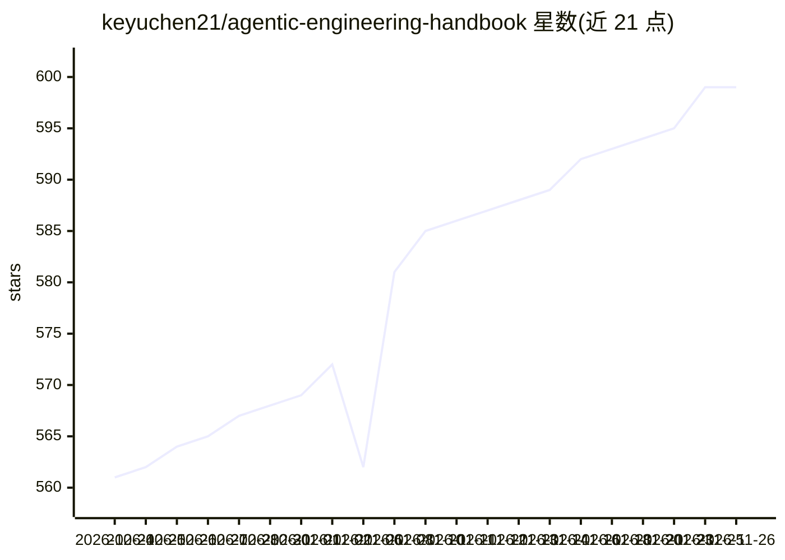

# keyuchen21/agentic-engineering-handbook

⭐ 599 · Python · MIT · 推送 2026-11-15 · [GitHub](https://github.com/keyuchen21/agentic-engineering-handbook) · 个人维护

**面向 Agent 工程师的结构化学习路线图：整合 231 份资源**

将散落在 OpenAI 博客、Anthropic 工程文章、SDK 文档、cookbook 与研究论文中的 Agent 工程知识，整合为带阶段划分的学习路线图，收录 231 条策展资源。按 Phase 0-7 组织，从零实现 Agent 循环（含 5 个 Python 代码文件）、Agent 基础、MCP 工具生态，到评测与生产实践，每阶段附 Read First/Then Read 阅读清单与 Build Exercise 练习，并按不同起点的学习者给出路径建议。

## 筛选速览

| 维度 | 判定 | 备注 |
|---|---|---|
| AI 角色 | `ai-knowledge` | 知识聚合/清单类 |
| 许可风险 | `permissive` | MIT |
| 部署形态 | `None` |  |
| 模型依赖 | — | README 未给出锁定关系 |
| 硬件要求 | — | 无带数字的原话,不猜 |
| 安装摩擦 | `low` | 无编译、无系统依赖或容器化 |
| 成熟度 | — | 结构信号不足 |

## 能力要点

- 收录 231 条策展资源，按阶段组织为结构化路线图
- Phase 0 提供从零实现 Agent 循环的代码实验（v0-v4 五个版本，含子代理与技能机制）
- 每阶段附阅读清单与 Build Exercise 练习
- 按学习者起点（新手/已有 LLM 应用经验/项目实践/查参考）给出路径建议

## 适用场景

- 系统学习 Agent、工具调用、MCP 与评测的工程师
- 已有 LLM 应用经验者补齐生产工程知识
- 按 Build Exercise 练习构建 Agent 项目

## 场景标签

`教程课程` · 领域:学习与行业

## 证据(README 行号)

> L14: This repository consolidates **231 curated resources** into one structured learning roadmap.
> L22: - **New to agents:** follow the Learning Roadmap through the core Phases 0–6, then continue to Phase 7 for advanced
> L46: ## Learning Roadmap

## 星数曲线

2026-10-24 561 → 2026-11-26 599（+38）

---
*卡片 v1 · prompt 1.4 · 生成 2026-11-25 · 置信度 high · 依据 README sha `b9873782ad78` · [字段定义](../../DATASET.md)*
