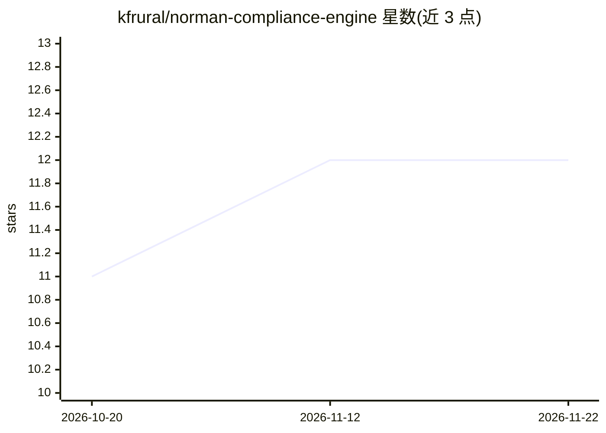

# kfrural/norman-compliance-engine

⭐ 12 · Java · MIT · 推送 2026-02-10 · [GitHub](https://github.com/kfrural/norman-compliance-engine) · 个人维护

**给土木工程师用 AI 自动校验项目是否符合巴西 NBR 规范**

基于 Spring Boot 3 的合规分析引擎：将巴西技术标准（NBR）处理后存入 PGVector 向量库，用 RAG 检索并调用 Google Gemini Pro 对结构项目文件（备忘录、计算书、规格说明）做自动审计，输出具体规范条目引用。基础设施经 Docker Compose 启动（PostgreSQL、Redis、Prometheus、Grafana、MinIO、Jaeger），提供 REST API 与 Swagger UI，支持 Gemini/OpenAI 多供应商切换与自动回退、无效 JSON 自纠错循环及可观测性仪表盘。需 Google Gemini API key，Java 21+ 与 Maven。

## 筛选速览

| 维度 | 判定 | 备注 |
|---|---|---|
| AI 角色 | `ai-native` | 本体是模型或模型工具 |
| 许可风险 | `permissive` | MIT |
| 部署形态 | `self-host` | docker 或自建部署 |
| 模型依赖 | — | README 未给出锁定关系 |
| 硬件要求 | — | 无带数字的原话,不猜 |
| 安装摩擦 | `low` | 无编译、无系统依赖或容器化 |
| 成熟度 | — | 结构信号不足 |

## 能力要点

- RAG 流程：规范入库 PGVector 向量库，检索后由 LLM 审计并给出规范条目引用
- 多供应商策略：Gemini/OpenAI 免改代码切换、失败自动回退、健康检查
- 无效 JSON 自动检测与重处理的自纠错循环，附成功率指标
- 完整可观测性：Jaeger 链路追踪、Prometheus 指标、Grafana 仪表盘

## 适用场景

- 结构项目文件提交前对照 NBR 规范做自动合规核查
- 替代人工逐条查找规范条目的文档审查流程
- 按合规率、严重度分布等指标跟踪项目合规状况

## 场景标签

`RAG` `文档问答` · 领域:知识与检索

## 证据(README 行号)

> L23: Civil engineering focused compliance analysis engine that uses **RAG (Retrieval-Augmented Generation)** to instantl
> L31: Robust backend in **Spring Boot 3** that processes Brazilian technical standards, stores them in **Vector Database 

## 星数曲线

2026-10-20 11 → 2026-11-22 12（+1）

---
*卡片 v1 · prompt 1.4 · 生成 2026-11-18 · 置信度 high · 依据 README sha `ea9b16c4440c` · [字段定义](../../DATASET.md)*
