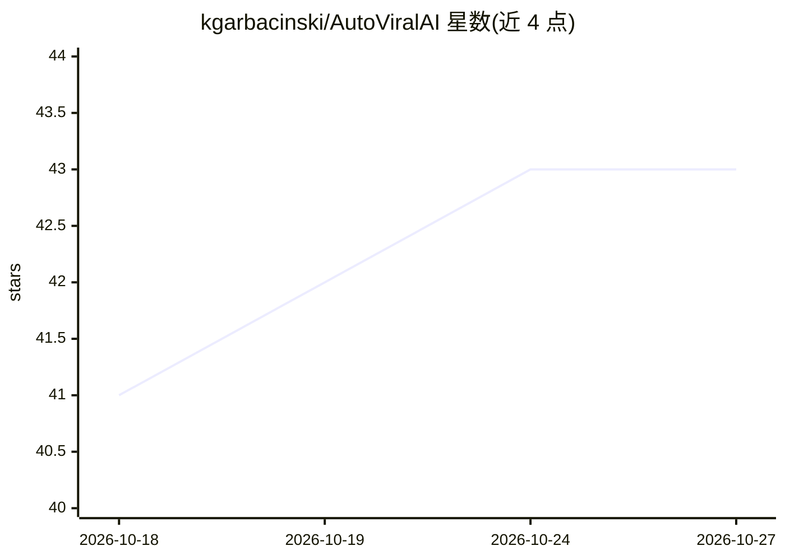

# kgarbacinski/AutoViralAI

⭐ 43 · Python · MIT · 推送 2026-10-16 · [GitHub](https://github.com/kgarbacinski/AutoViralAI) · 个人维护

**自主运营 Threads 账号的 AI 内容代理：研究热点、生成、发布、自学习**

基于 LangGraph 双图架构的自主内容代理：创建管线每日多次抓取 Threads 与 HackerNews 热点、提取爆款模式、用 Claude 生成帖子并按三信号（AI 评分、模式历史表现、新颖度）排序；学习管线每日分析昨日互动数据回写策略。所有帖子经 Telegram 人工审批（interrupt() 可在重启后恢复）后才发布。运行需 Python 3.13+ 与 Anthropic API key，首次运行用 mock 数据无需社交账号；生产部署用 PostgreSQL + Docker。目前仅支持 Threads 平台，多平台在路线图中。

## 筛选速览

| 维度 | 判定 | 备注 |
|---|---|---|
| AI 角色 | `ai-native` | 本体是模型或模型工具 |
| 许可风险 | `permissive` | MIT |
| 部署形态 | `None` |  |
| 模型依赖 | locked-api |  |
| 硬件要求 | — | 无带数字的原话,不猜 |
| 安装摩擦 | `low` | 无编译、无系统依赖或容器化 |
| 成熟度 | — | 结构信号不足 |

## 能力要点

- 研究→提取→生成→排序→发布→学习→自适应的闭环管线
- 多信号排序：AI 评分 + 历史模式表现 + 嵌入余弦新颖度
- LangGraph interrupt() 实现 Telegram 人工审批，重启后可恢复
- YAML 定义利基/语气/受众，两条管线共享 LangGraph Store 知识库

## 适用场景

- 自动运营一个 Threads 技术账号并按互动数据迭代策略
- 让我审批 AI 生成的候选帖子后定时发布
- 查看代理的管线报告了解研究、模式提取与排序过程

## 场景标签

`AI 写作` `工作流自动化` · 领域:效率与自动化

## 证据(README 行号)

> L13: An autonomous AI agent that researches what's going viral, generates content,
> L58: AutoViralAI does the entire loop autonomously. It doesn't just post — it ***learns***. Every day it gets a little b
> L141:     subgraph creation ["Content Creation Pipeline · runs 3x/day"]

## 星数曲线

2026-10-18 41 → 2026-10-27 43（+2）

---
*卡片 v1 · prompt 1.4 · 生成 2026-10-25 · 置信度 high · 依据 README sha `b98f75bdb7e1` · [字段定义](../../DATASET.md)*
