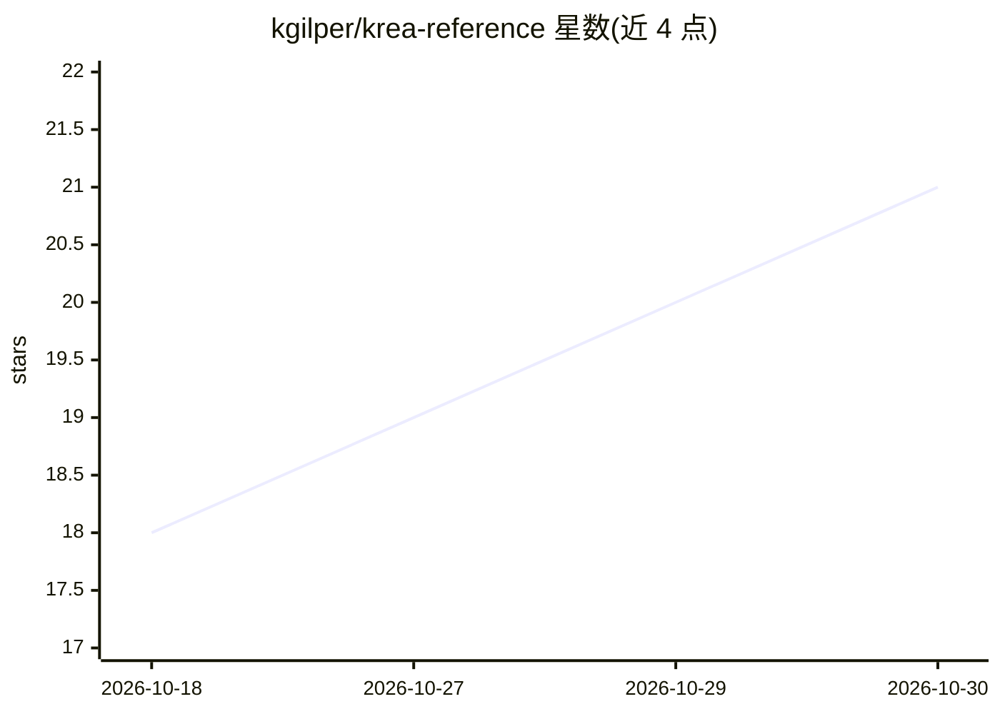

# kgilper/krea-reference

⭐ 21 · Python · MIT · 推送 2026-10-29 · [GitHub](https://github.com/kgilper/krea-reference) · 个人维护

**用参考图引导 Krea 2 生成的 ComfyUI 自定义节点集**

面向 ComfyUI 用户的自定义节点包（当前版本 V11），提供两类工具：参考卡（最多 12 张，为输入图像指定主体、风格、光照、布局或反例任务，经 Reference Stack Encoder 送入采样器）与概念滑块（最多 8 张，把文字描述转为属性控制，无需训练）。安装需通过 ComfyUI Manager/Registry 或克隆到 custom_nodes 目录，模型权重（Krea 2 diffusion、Qwen3-VL 编码器、Qwen VAE）需自行准备。README 注明参考边框、细纹理迁移与属性纠缠等限制。

## 筛选速览

| 维度 | 判定 | 备注 |
|---|---|---|
| AI 角色 | `ai-ecosystem` | LLM/agent 周边工具 |
| 许可风险 | `permissive` | MIT |
| 部署形态 | `None` |  |
| 模型依赖 | — | README 未给出锁定关系 |
| 硬件要求 | — | 无带数字的原话,不猜 |
| 安装摩擦 | `low` | 无编译、无系统依赖或容器化 |
| 成熟度 | `idea` | |

## 能力要点

- 最多 12 张参考卡的 V11 reference stack，用自然语言配方分配任务
- 概念滑块把文本描述转为属性控制，无需训练或额外权重
- 支持自动 reach/budget 与逐卡时序控制
- 附 Recipe Builder（web/recipe-builder.html）与示例工作流

## 适用场景

- 在 ComfyUI 中用参考图保持主体并借用风格/配色/光照
- 用文本定义的滑块微调生成图像属性（如亮度）
- 组合多张参考卡做产品与平面参考的引导生成

## 场景标签

`图像生成` · 领域:内容生成

## 证据(README 行号)

> L3: Guide Krea 2 with reference images and training-free concept sliders. **V11 is the current version to start with**, 
> L45: Install **Krea Reference** through ComfyUI Manager/Registry, or clone this repository into your ComfyUI custom_node

## 星数曲线

2026-10-18 18 → 2026-10-30 21（+3）

---
*卡片 v1 · prompt 1.4 · 生成 2026-10-28 · 置信度 high · 依据 README sha `e55d6a5e7321` · [字段定义](../../DATASET.md)*
