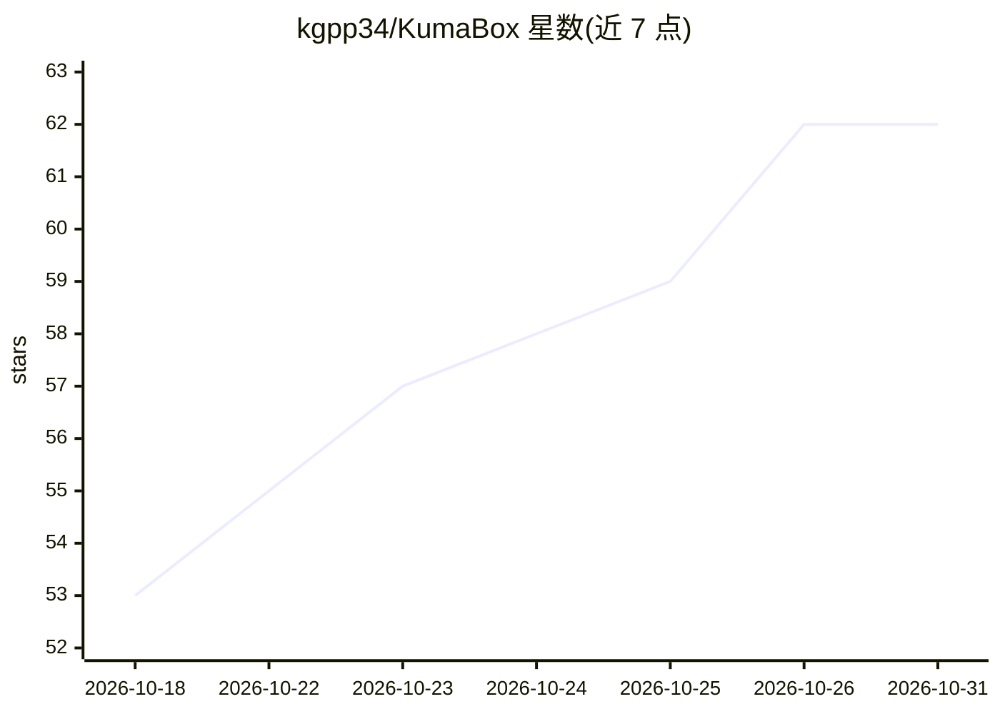

# kgpp34/KumaBox

⭐ 62 · Go · MIT · 推送 2026-10-30 · [GitHub](https://github.com/kgpp34/KumaBox) · 个人维护 · 中文 README

**面向 AI agent 与不可信负载的 KVM microVM 沙箱运行时**

Go 编写的单机 microVM 沙箱运行时：将摘要固定的 OCI 镜像转为 EROFS 只读层加私有写时复制磁盘，每个沙箱由独立 Cloud Hypervisor 进程承载 KVM 隔离的 guest 内核、独立网络命名空间与 TAP/CNI 网络。提供 vsock exec（无需 SSH）、运行态快照/克隆/迁移、CPU 与内存策略、virtio-fs 共享、端口转发等能力，SQLite 记录状态。供 agent 框架、评测 harness、CI 驱动任意命令运行；需 Linux amd64/arm64、/dev/kvm 与 root，当前处于 0.x 系列，E2B 协议适配器仍为实验性。

## 筛选速览

| 维度 | 判定 | 备注 |
|---|---|---|
| AI 角色 | `ai-ecosystem` | LLM/agent 周边工具 |
| 许可风险 | `permissive` | MIT |
| 部署形态 | `self-host` | docker 或自建部署 |
| 模型依赖 | — | README 未给出锁定关系 |
| 硬件要求 | — | 无带数字的原话,不猜 |
| 安装摩擦 | `low` | 无编译、无系统依赖或容器化 |
| 成熟度 | `idea` | |

## 能力要点

- 每任务一个 KVM microVM：独立内核、磁盘与网络命名空间
- OCI 镜像进、microVM 出，一条命令从镜像到运行沙箱
- 运行态快照为一级对象：保存/恢复/休眠/克隆/导入导出
- vsock exec 免 SSH 执行、分离进程管理与端口转发

## 适用场景

- 让编码 agent 在硬件级隔离沙箱中执行代码与安装依赖
- 评测/强化学习场景预热一次、快照后批量克隆尝试
- 为不可信自动化任务提供独立内核与网络隔离的执行环境

## 场景标签

 · 领域:基础设施/沙箱运行时

## 证据(README 行号)

> L31: KumaBox is a **microVM sandbox runtime for AI agents and untrusted
> L34: Anything that can run a command can drive it today: a coding agent, an agent framework's tool call,
> L35: an RL or eval harness fanning out thousands of attempts, a CI job, or you at a

## 星数曲线

2026-10-18 53 → 2026-10-31 62（+9）

---
*卡片 v1 · prompt 1.4 · 生成 2026-10-24 · 置信度 mid · 依据 README sha `51280a2556c0` · [字段定义](../../DATASET.md)*
