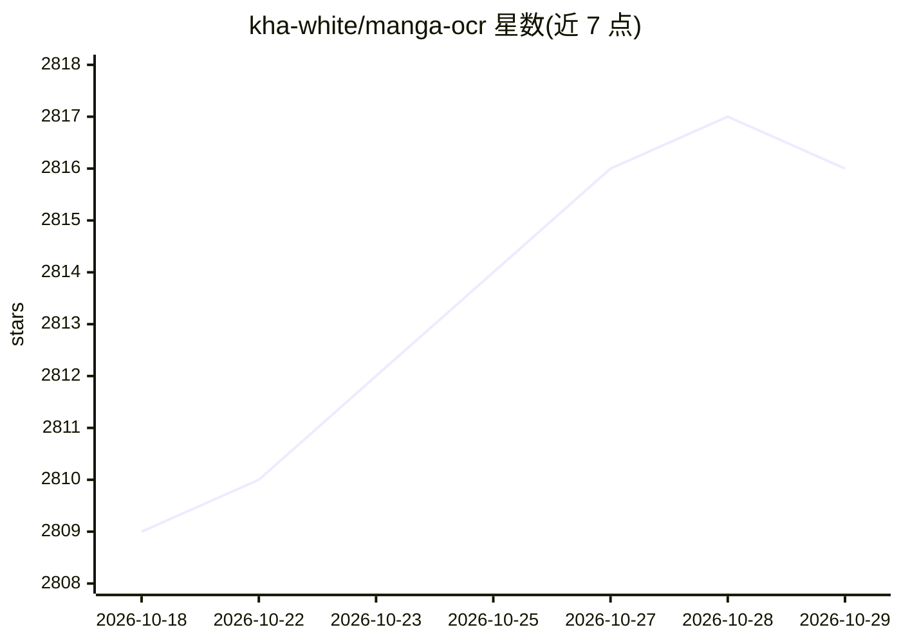

# kha-white/manga-ocr

⭐ 2,816 · Python · Apache-2.0 · 推送 2026-07-19 · [GitHub](https://github.com/kha-white/manga-ocr) · 个人维护

**面向日本漫画的日文文本 OCR 库**

基于 Transformers Vision Encoder Decoder 框架的端到端模型，识别日文文本，主要针对漫画场景：竖排/横排文字、带振假名、叠加在图像上的文字、多种字体与低质量图像；单次前向传播即可识别多行文本，无需按行切分。也可作为通用印刷日文 OCR 使用，不支持手写文字；无文字时模型也可能输出内容。提供 Python API、命令行后台模式（剪贴板/目录监听），首次运行需下载约 400MB 模型。

## 筛选速览

| 维度 | 判定 | 备注 |
|---|---|---|
| AI 角色 | `ai-native` | 本体是模型或模型工具 |
| 许可风险 | `permissive` | Apache-2.0 |
| 部署形态 | `library` | 以包/库形式分发 |
| 模型依赖 | — | README 未给出锁定关系 |
| 硬件要求 | — | 无带数字的原话,不猜 |
| 安装摩擦 | `low` | 无编译、无系统依赖或容器化 |
| 成熟度 | — | 结构信号不足 |

## 能力要点

- 单次前向传播支持多行文本识别
- 针对漫画场景：竖排/横排、振假名、图上文字、低质量图像
- 提供剪贴板/目录监听的后台 OCR 模式，可与 ShareX、Yomitan 组成查词工作流
- 提供 Python API 与命令行两种使用方式

## 适用场景

- 阅读日文漫画时截图查词（配合 Yomitan 等词典）
- 批量提取漫画或印刷日文文本
- 作为通用印刷日文 OCR 使用（小说、游戏等）

## 场景标签

`OCR` · 领域:感知与多模态

## 证据(README 行号)

> L3: Optical character recognition for Japanese text, with the main focus being Japanese manga.
> L4: It uses a custom end-to-end model built with Transformers' Vision Encoder Decoder framework.

## 星数曲线

2026-10-18 2,809 → 2026-10-29 2,816（+7）

---
*卡片 v1 · prompt 1.4 · 生成 2026-10-21 · 置信度 high · 依据 README sha `16f184cf1db6` · [字段定义](../../DATASET.md)*
