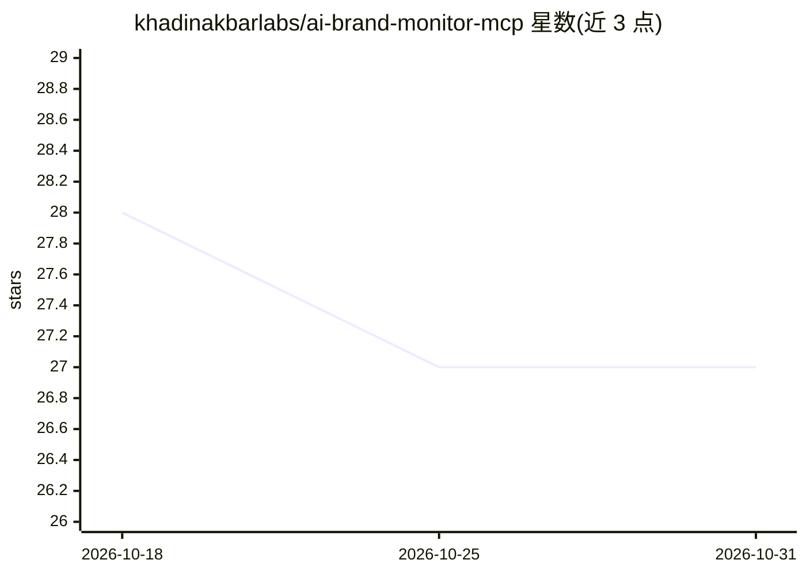

# khadinakbarlabs/ai-brand-monitor-mcp

⭐ 27 · TypeScript · MIT · 推送 2026-06-06 · [GitHub](https://github.com/khadinakbarlabs/ai-brand-monitor-mcp) · [官网](https://apify.com/khadinakbar/ai-search-brand-monitor) · 个人维护

**MCP 服务器：让 AI agent 追踪品牌在四大 AI 搜索中的可见度**

一个 Model Context Protocol 服务器，供 Claude、Cursor、Codex、Windsurf、VS Code、ChatGPT 等 MCP 客户端调用，在 Perplexity、ChatGPT、Claude、Gemini 四个平台检索品牌相关查询，返回提及率、位置分、引用检测、情感与竞品共现，并聚合为 0–100 的 GEO 分与建议。后端为 Apify actor，每次检查计费 $0.08。提供两种安装：云端 MCP（Apify OAuth，约 30 秒）与自托管 npm（需 Node 18+ 与 Apify token）。

## 筛选速览

| 维度 | 判定 | 备注 |
|---|---|---|
| AI 角色 | `ai-ecosystem` | LLM/agent 周边工具 |
| 许可风险 | `permissive` | MIT |
| 部署形态 | `library` | 以包/库形式分发 |
| 模型依赖 | — | README 未给出锁定关系 |
| 硬件要求 | — | 无带数字的原话,不猜 |
| 安装摩擦 | `low` | 无编译、无系统依赖或容器化 |
| 成熟度 | — | 结构信号不足 |

## 能力要点

- 跨 Perplexity/ChatGPT/Claude/Gemini 四平台运行同一提示并统一打分
- 返回提及率、位置分、引用检测、情感、竞品共现与 0–100 GEO 聚合分
- 云端 OAuth 接入（一条 URL）与 npm 自托管两种方式
- 两个工具：模板化品牌审计 audit_brand_visibility 与自定义查询 check_brand_in_queries

## 适用场景

- 营销人员让 AI agent 定期审计品牌在 AI 搜索中的可见度
- 对比自家品牌与竞品在同一批查询中的提及与引用情况
- 内容发布前后测量 GEO 分变化以评估 AI 搜索优化效果

## 场景标签

`数据分析` · 领域:效率与自动化

## 证据(README 行号)

> L17: A Model Context Protocol server that gives any MCP-compatible AI agent a single, reliable way to measure brand visi
> L38: Traditional brand-monitoring tools live in a separate dashboard. This one lives **inside the agent**: Claude, Curso

## 星数曲线

2026-10-18 28 → 2026-10-31 27（-1）

---
*卡片 v1 · prompt 1.4 · 生成 2026-10-26 · 置信度 high · 依据 README sha `374aeb6e59cd` · [字段定义](../../DATASET.md)*
