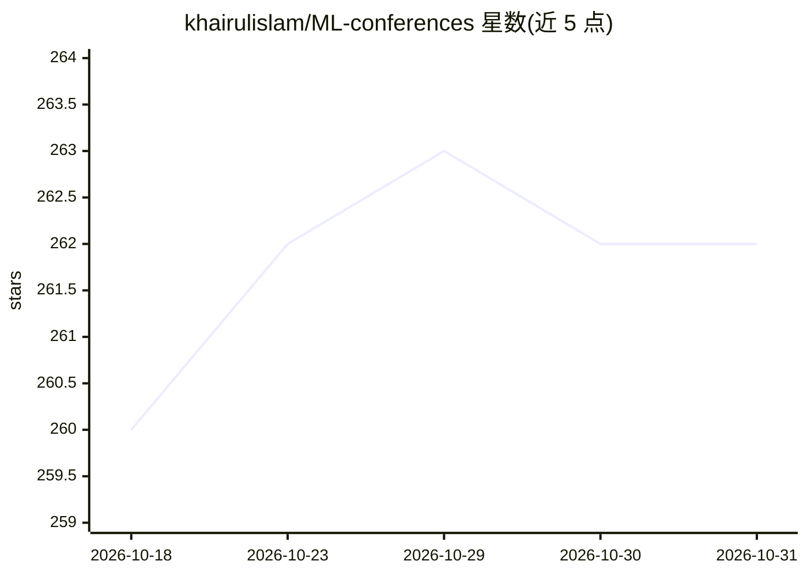

# khairulislam/ML-conferences

⭐ 262 · Jupyter Notebook · MIT · 推送 2026-08-17 · [GitHub](https://github.com/khairulislam/ML-conferences) · [官网](https://khairulislam.github.io/ML-conferences) · 个人维护

**机器学习会议清单：截稿日期、地点与录用论文列表**

以 Markdown 表格整理机器学习与数据挖掘相关会议信息的清单项目：按会议（ICML、NeurIPS、ICLR、AAAI、KDD、CIKM 等）列出年份、举办时间与地点、投稿截止日期（含摘要截止）及官网链接，并维护近期会议的开放/关闭状态。信息来源引用 DBLP 及 CCF-Deadlines、AI Deadlines 等项目。供研究人员跟踪投稿窗口，通过 PR 更新数据。

## 筛选速览

| 维度 | 判定 | 备注 |
|---|---|---|
| AI 角色 | `ai-knowledge` | 知识聚合/清单类 |
| 许可风险 | `permissive` | MIT |
| 部署形态 | `None` |  |
| 模型依赖 | — | README 未给出锁定关系 |
| 硬件要求 | — | 无带数字的原话,不猜 |
| 安装摩擦 | `low` | 无编译、无系统依赖或容器化 |
| 成熟度 | — | 结构信号不足 |

## 能力要点

- 按会议分组的历年时间/地点/截止日期表格
- 近期会议的投稿状态（Open/Closed）跟踪
- 条目附 DBLP 与官网链接

## 适用场景

- 查找目标会议的投稿截止日期与举办信息
- 对比多个会议的时间安排以规划投稿
- 通过 DBLP 链接查阅会议论文列表

## 场景标签

`精选清单` `科研工具` · 领域:学习与行业

## 证据(README 行号)

> L3: This project lists the Machine Learning and Data Mining related conferences with their important date and list of ac
> L57: Check Acceptance rates for the major top-tier AI-related conferences.

## 星数曲线

2026-10-18 260 → 2026-10-31 262（+2）

---
*卡片 v1 · prompt 1.4 · 生成 2026-10-22 · 置信度 high · 依据 README sha `af60c40c76fd` · [字段定义](../../DATASET.md)*
