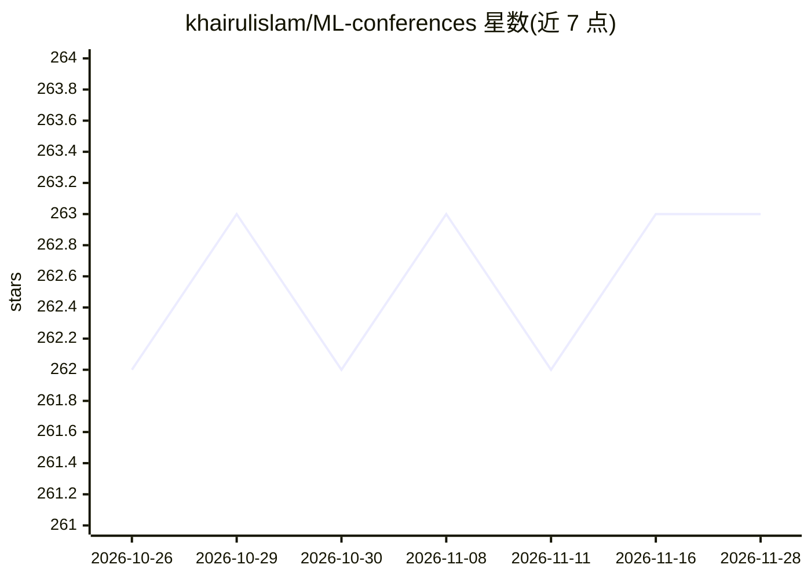

# khairulislam/ML-conferences

⭐ 263 · Jupyter Notebook · MIT · 推送 2026-11-12 · [GitHub](https://github.com/khairulislam/ML-conferences) · [官网](https://khairulislam.github.io/ML-conferences) · 个人维护

**ML/数据挖掘会议时间与接收论文清单，供投稿查询**

以 Markdown 表格收录机器学习与数据挖掘相关会议（ICML、NeurIPS、ICLR、AAAI、IJCAI、KDD、CIKM、MLSys 等），列出各届会议的举办时间、地点、投稿截止日期、官网链接，并维护近期会议的 Open/Closed 状态；按 AI & ML 与 Data Mining 分类组织，另附接收率统计与相关截止日期聚合站的资源链接。README 未提供安装或运行方式，属静态信息清单。

## 筛选速览

| 维度 | 判定 | 备注 |
|---|---|---|
| AI 角色 | `ai-knowledge` | 知识聚合/清单类 |
| 许可风险 | `permissive` | MIT |
| 部署形态 | `None` |  |
| 模型依赖 | — | README 未给出锁定关系 |
| 硬件要求 | — | 无带数字的原话,不猜 |
| 安装摩擦 | `low` | 无编译、无系统依赖或容器化 |
| 成熟度 | — | 结构信号不足 |

## 能力要点

- 收录 ICML/NeurIPS/ICLR/AAAI/IJCAI/KDD 等会议的历史与近期时间表
- 按年份列出各会议举办地、截止日期与官网链接
- 近期会议表标注 Open/Closed 投稿状态
- 附接收率统计与截止日期聚合站资源链接

## 适用场景

- 查询目标会议今年的投稿截止日期
- 规划论文投稿与时间安排
- 查找某会议历届举办信息与官网

## 场景标签

`精选清单` `科研工具` · 领域:学习与行业

## 证据(README 行号)

> L3: This project lists the Machine Learning and Data Mining related conferences with their important date and list of ac
> L51: ## AI & ML
> L150: ## Data Mining

## 星数曲线

2026-10-26 262 → 2026-11-28 263（+1）

---
*卡片 v1 · prompt 1.4 · 生成 2026-11-25 · 置信度 high · 依据 README sha `6159fbcb185b` · [字段定义](../../DATASET.md)*
