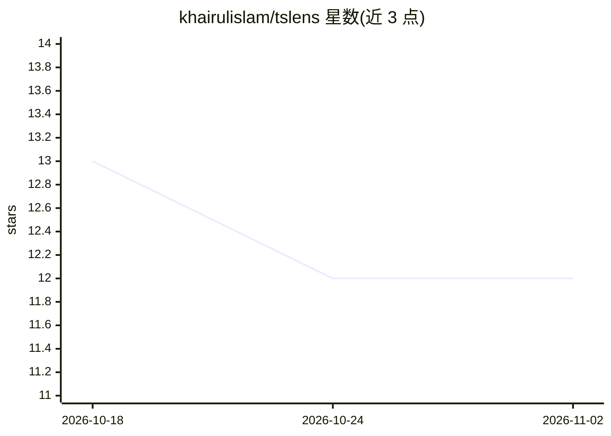

# khairulislam/tslens

⭐ 12 · Jupyter Notebook · MIT · 推送 2026-08-25 · [GitHub](https://github.com/khairulislam/tslens) · [官网](https://khairulislam.github.io/tslens/) · 个人维护

**面向时间序列 PyTorch 模型的可解释性/归因工具库**

Captum 兼容的时间序列模型解释框架：对任意接收 (batch, seq_len, n_features) 的 PyTorch 可调用模型做归因，输出覆盖时间步与特征的显著性图。聚合十余种方法（原生 WinTSR/WinIT 等，及接入 Captum 与 Time Interpret），统一 API。已测试与 TSlib 的 25+ 种架构（DLinear、iTransformer、TimesNet 等）及 Timer/MOMENT/TTM/CALF/GPT4TS/TimeLLM 等时间序列基础模型的集成，支持分类与多步预测、自定义基线与 dict/tuple 输出。以 pip 包提供，附 notebook、测试与文档；需 Python 3.9+ 与 PyTorch 1.13+。

## 筛选速览

| 维度 | 判定 | 备注 |
|---|---|---|
| AI 角色 | `ai-ecosystem` | LLM/agent 周边工具 |
| 许可风险 | `permissive` | MIT |
| 部署形态 | `library` | 以包/库形式分发 |
| 模型依赖 | — | README 未给出锁定关系 |
| 硬件要求 | — | 无带数字的原话,不猜 |
| 安装摩擦 | `low` | 无编译、无系统依赖或容器化 |
| 成熟度 | — | 结构信号不足 |

## 能力要点

- 十余种时间感知归因方法统一在一个 API 下
- 与 TSlib 25+ 架构及多个时间序列基础模型有测试集成
- 输出联合时间–特征显著性图，支持逐预测步长归因
- 兼容 Captum 与 Time Interpret，方法可互换调用

## 适用场景

- 解释预测模型实际使用了哪些时间步与特征
- 对零样本或微调后的时间序列基础模型做归因分析
- 为时间序列深度学习研究复现论文中的解释方法

## 场景标签

 · 领域:机器学习可解释性/时间序列

## 证据(README 行号)

> L13: tslens is a drop-in, Captum-compatible interpretability toolkit for PyTorch time-series
> L138: One interface, over a dozen methods, works with any PyTorch time-series model. The

## 星数曲线

2026-10-18 13 → 2026-11-02 12（-1）

---
*卡片 v1 · prompt 1.4 · 生成 2026-11-01 · 置信度 high · 依据 README sha `2795d4da3366` · [字段定义](../../DATASET.md)*
