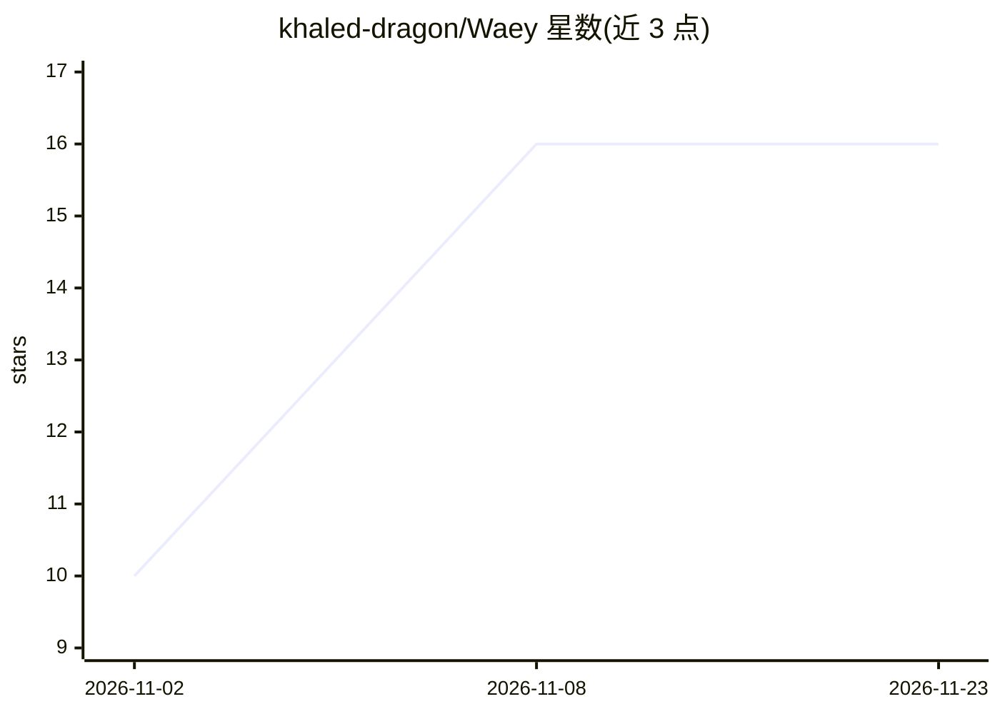

# khaled-dragon/Waey

⭐ 16 · Rust · 推送 2026-10-17 · [GitHub](https://github.com/khaled-dragon/Waey) · [官网](https://waey-ai.vercel.app/) · 个人维护

**屏幕感知 AI 桌面助手：随时向 LLM 提问当前屏幕内容**

基于 Tauri 2 + Rust + React 的桌面覆盖层应用：全局快捷键唤起常置顶层悬浮窗，捕获截图与可读屏幕结构（Windows UI Automation 提供窗口、控件、选中文本等上下文），发送至 OpenAI 兼容的模型并流式返回回答。提供分步 Guide Mode 与需逐步确认的 Action Mode（单次受控点击/输入/滚动），可选 Developer Mode 读取允许工作区内的代码与表格上下文。支持 OpenRouter、Ollama、Groq 与自定义端点，数据本地 SQLite 存储；可读屏幕上下文目前为 Windows 功能，其他系统回退为截图模式。

## 筛选速览

| 维度 | 判定 | 备注 |
|---|---|---|
| AI 角色 | `ai-native` | 本体是模型或模型工具 |
| 许可风险 | `none` | — |
| 部署形态 | `desktop` | 安装包/桌面程序 |
| 模型依赖 | local-ok | 支持本地模型 |
| 硬件要求 | — | 无带数字的原话,不猜 |
| 安装摩擦 | `low` | 无编译、无系统依赖或容器化 |
| 成熟度 | `idea` | |

## 能力要点

- 截图与可读屏幕结构（Windows UI Automation）独立路由，文字模型也可用
- Guide Mode 分步引导与 Action Mode 单步受验操作（Apply/Dismiss 确认）
- OpenAI 兼容多 provider：OpenRouter、Ollama、Groq、自定义 base URL
- 本地 SQLite 存储会话、设置、personas 与 provider 配置

## 适用场景

- 在任意应用上方唤起 AI，直接询问当前屏幕内容而不切换窗口
- 跟随分步指引完成桌面操作任务
- 让 AI 读取允许的工作区文件辅助编码与表格处理

## 场景标签

`AI 助手` `GUI 自动化` · 领域:效率与自动化

## 证据(README 行号)

> L3: Waey is a screen-aware desktop AI assistant for people who do not want to pause their flow just to explain what is a
> L5: Open it with a global shortcut, ask a question, and keep working from the same overlay. Waey can combine optional sc
> L9: Waey sits quietly on your desktop and opens as an always-on-top overlay when you need it. It streams model responses

## 星数曲线

2026-11-02 10 → 2026-11-23 16（+6）

---
*卡片 v1 · prompt 1.4 · 生成 2026-11-18 · 置信度 high · 依据 README sha `4a1e3e083062` · [字段定义](../../DATASET.md)*
