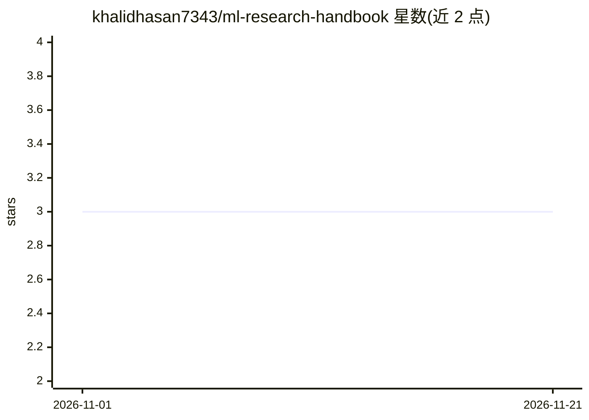

# khalidhasan7343/ml-research-handbook

⭐ 3 · NOASSERTION · 推送 2026-11-01 · [GitHub](https://github.com/khalidhasan7343/ml-research-handbook) · 个人维护

**英孟双语机器学习与研究方法手册：读论文、找研究缺口**

个人学术参考手册项目，提供 Markdown/PDF（101 页）/DOCX 三种版本，共 34 个编号章节，内容版本 4.0。内容从机器学习基础、算法与实验设计，到论文阅读三遍法、笔记与分析模板、16 类研究缺口与 14 步检测框架、可复现性与学术出版流程，附 AlexNet 案例研究与公式算例。面向学生与早期研究者，全文以英语与孟加拉语双语呈现；内容采用 CC BY-NC-ND 4.0 许可，禁止分发改编版本。

## 筛选速览

| 维度 | 判定 | 备注 |
|---|---|---|
| AI 角色 | `ai-knowledge` | 知识聚合/清单类 |
| 许可风险 | `permissive` | NOASSERTION |
| 部署形态 | `None` |  |
| 模型依赖 | — | README 未给出锁定关系 |
| 硬件要求 | — | 无带数字的原话,不猜 |
| 安装摩擦 | `low` | 无编译、无系统依赖或容器化 |
| 成熟度 | — | 结构信号不足 |

## 能力要点

- 34 章覆盖 ML 基础、论文精读、研究缺口识别到研究问题构建
- 16 类研究缺口分类与 14 步缺口检测框架、缺口核实清单
- 提供论文笔记、摘要分析、一页总结等模板与 14 维批判分析框架
- 英/孟双语行文，附 AlexNet 完整案例与公式算例

## 适用场景

- 按学习路径系统补机器学习与深度学习基础
- 读 ML 论文时套用三遍法和分析模板做笔记
- 找论文方向时区分研究缺口与局限性并验证
- 投稿前检查实验设计、可复现性与论文红旗项

## 场景标签

`教程课程` · 领域:学习与行业

## 证据(README 行号)

> L11: ML Research Handbook is a personal academic study and reference project for students and early-career researchers. 
> L23: All three editions contain **34 numbered sections**, ending with **References & Further Reading**. The handbook ide
> L27: The handbook progresses from beginner vocabulary to algorithms, evaluation, experimental design, and critical resea

## 星数曲线

2026-11-01 3 → 2026-11-21 3（+0）

---
*卡片 v1 · prompt 1.4 · 生成 2026-11-21 · 置信度 high · 依据 README sha `c0edda2fa7b8` · [字段定义](../../DATASET.md)*
