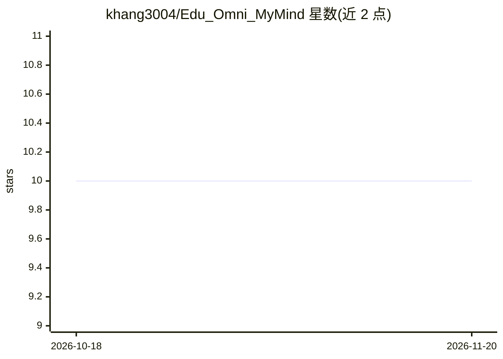

# khang3004/Edu_Omni_MyMind

⭐ 10 · Python · MIT · 推送 2026-06-23 · [GitHub](https://github.com/khang3004/Edu_Omni_MyMind) · [官网](https://khang3004.github.io/Edu_Omni_MyMind/) · 个人维护

**面向双语课堂的多模态转录翻译与 RAG 助手**

面向越南语—英语混说（code-mixed）学术环境的课程助手与主动学习流水线：用 Whisper 转录双语语音并计算置信度，计算语码混用指数（CMI），通过可插拔策略（规则词典/HuggingFace 神经模型）翻译并保留术语，对幻灯片做布局感知 PDF 分块并索引到 Qdrant，执行带交叉编码器重排序的 RAG。集成 Label Studio 构成人机协同主动学习闭环，人工修正文本即时入库形成 gold-standard 语料。需 uv 管理 Python 3.10 环境，前端为 Streamlit。

## 筛选速览

| 维度 | 判定 | 备注 |
|---|---|---|
| AI 角色 | `ai-native` | 本体是模型或模型工具 |
| 许可风险 | `permissive` | MIT |
| 部署形态 | `self-host` | docker 或自建部署 |
| 模型依赖 | — | README 未给出锁定关系 |
| 硬件要求 | — | 无带数字的原话,不猜 |
| 安装摩擦 | `low` | 无编译、无系统依赖或容器化 |
| 成熟度 | — | 结构信号不足 |

## 能力要点

- Whisper 双语语音转录，动态 CPU/MPS/CUDA 硬件检测
- token 级语言识别与 Code-Mixing Index（CMI）计算
- Anti-Forget RAG：布局感知分块、混合检索、交叉编码器重排序
- Label Studio 人机协同闭环，修正数据即时更新 Qdrant 知识库

## 适用场景

- 转录并整理越英混说的课堂录音与讲义
- 为混语种课程材料建立可检索的问答知识库
- 通过人工标注持续改进翻译与语料质量

## 场景标签

`RAG` `语音识别` `文档问答` · 领域:知识与检索

## 证据(README 行号)

> L10: **EduMIND** is an enterprise-grade, highly modular **Bilingual Lecture Assistant & Active Learning Pipeline**. Desi
> L40: * Supports pluggable generative models (e.g. Gemini, Groq) via LangChain integrations.

## 星数曲线

2026-10-18 10 → 2026-11-20 10（+0）

---
*卡片 v1 · prompt 1.4 · 生成 2026-11-19 · 置信度 high · 依据 README sha `e5884182cb43` · [字段定义](../../DATASET.md)*
