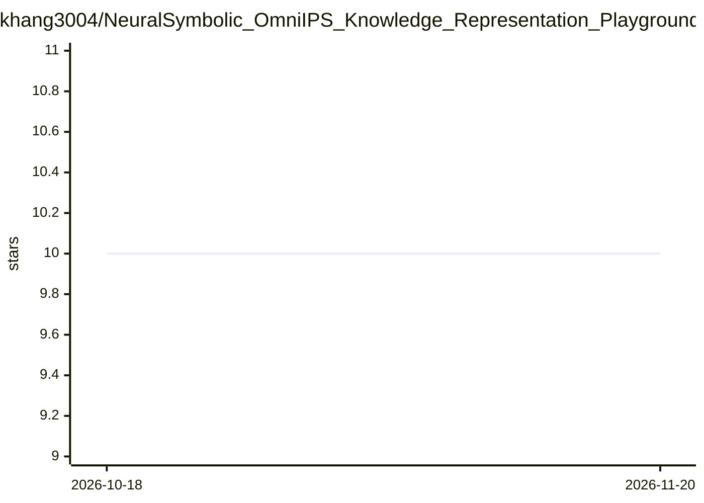

# khang3004/NeuralSymbolic_OmniIPS_Knowledge_Representation_Playground

⭐ 10 · Python · 推送 2026-08-24 · [GitHub](https://github.com/khang3004/NeuralSymbolic_OmniIPS_Knowledge_Representation_Playground) · 个人维护 · 中文 README

**欧氏几何定理证明的神经符号推理系统，供科研与教学使用**

面向欧氏平面几何定理证明的神经符号系统：一阶逻辑前向链推演内核结合 SymPy 计算机代数引擎处理角 chase 与比例计算；符号引擎饱和时由 LLM Agent 生成辅助点、垂线、外接圆等辅助元素续推。知识层由 Neo4j 属性图（1,128 节点、1,532 关系）与 Qdrant 向量库构成 GraphRAG 语义检索。经 FastAPI 与 Streamlit 提供 API 与双语逐步证明界面，附 15 题基准测试套件。项目为越南 PPU 大学研究生的知识表示课程报告。

## 筛选速览

| 维度 | 判定 | 备注 |
|---|---|---|
| AI 角色 | `ai-native` | 本体是模型或模型工具 |
| 许可风险 | `none` | — |
| 部署形态 | `self-host` | docker 或自建部署 |
| 模型依赖 | — | README 未给出锁定关系 |
| 硬件要求 | — | 无带数字的原话,不猜 |
| 安装摩擦 | `low` | 无编译、无系统依赖或容器化 |
| 成熟度 | — | 结构信号不足 |

## 能力要点

- 一阶逻辑前向链推演内核与 SymPy 计算机代数引擎结合
- 符号引擎饱和时 LLM Agent 生成辅助几何元素续推
- Neo4j 属性图 + Qdrant 向量库构成 GraphRAG 语义检索层
- 15 题几何基准测试套件（入学考试至奥赛难度）

## 适用场景

- 输入自然语言几何题，获取形式化逐步证明
- 以奥赛几何定理（Ceva、Menelaus、Simson 线等）测试推演引擎
- 教学场景中查看双语定理讲解与 LaTeX 证明树

## 场景标签

`知识图谱` `RAG` `科研工具` `模型评测` · 领域:评测与运维

## 证据(README 行号)

> L19: - **100% Deterministic & Formal (0% Hallucination)**: Pure First-Order Logic (FOL) forward-chaining deduction kerne
> L21: - **LLM-Powered Auxiliary Construction Agent**: Automatically generates essential auxiliary points, perpendiculars,
> L33: 1. **Presentation Layer (Streamlit UI)**: Handles natural language geometry input, live SSE proof streaming, and in

## 星数曲线

2026-10-18 10 → 2026-11-20 10（+0）

---
*卡片 v1 · prompt 1.4 · 生成 2026-11-19 · 置信度 high · 依据 README sha `397ecee7d7e5` · [字段定义](../../DATASET.md)*
