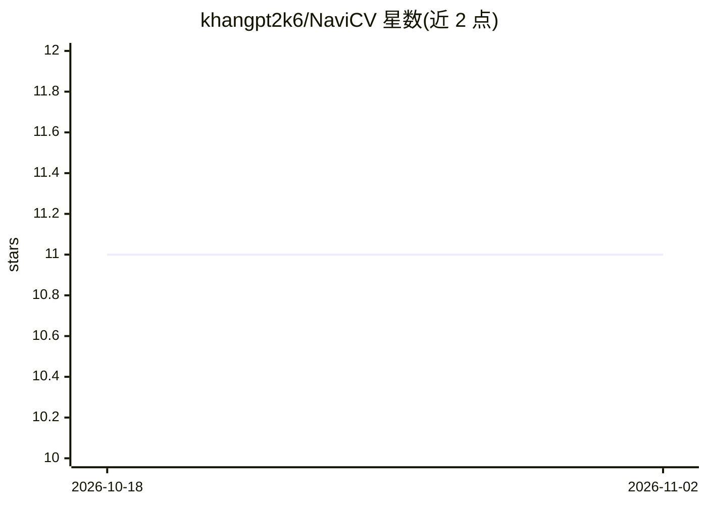

# khangpt2k6/NaviCV

⭐ 11 · JavaScript · 推送 2026-02-19 · [GitHub](https://github.com/khangpt2k6/NaviCV) · [官网](https://navicv.vps.phuchoang.sbs/) · 个人维护

**AI 求职助手：简历分析与多来源职位匹配**

基于 React 前端与 FastAPI 后端的 AI 求职助理应用：从简历中抽取技能、经历与薄弱点，计算 ATS（招聘跟踪系统）评分，并从 RemoteOK 与 Adzuna API 拉取职位，利用机器学习、语义搜索与向量嵌入做基于简历内容的职位匹配。面向求职者，提供在线 Demo，支持本地开发模式与 Docker Compose 部署，后端需安装 spaCy 英文模型。

## 筛选速览

| 维度 | 判定 | 备注 |
|---|---|---|
| AI 角色 | `ai-native` | 本体是模型或模型工具 |
| 许可风险 | `none` | — |
| 部署形态 | `self-host` | docker 或自建部署 |
| 模型依赖 | — | README 未给出锁定关系 |
| 硬件要求 | — | 无带数字的原话,不猜 |
| 安装摩擦 | `low` | 无编译、无系统依赖或容器化 |
| 成熟度 | — | 结构信号不足 |

## 能力要点

- 从简历抽取技能、经历并检测简历薄弱点
- ATS 评分计算与优化
- 从 RemoteOK 和 Adzuna 多来源拉取职位
- 基于简历内容的 AI 职位匹配（语义搜索与向量嵌入）

## 适用场景

- 上传简历获取技能与薄弱点分析
- 优化简历以通过 ATS 筛选
- 根据简历内容找到匹配的职位机会

## 场景标签

`语义搜索` · 领域:知识与检索

## 证据(README 行号)

> L3: NaviCV is an all-in-one AI-powered career assistant that offers advanced resume analysis, ATS optimization, and smar
> L9: - **AI Resume Analysis**: Extract skills, experience, and insights from resumes
> L12: - **Job Matching**: AI-powered job matching based on resume content

## 星数曲线

2026-10-18 11 → 2026-11-02 11（+0）

---
*卡片 v1 · prompt 1.4 · 生成 2026-11-02 · 置信度 high · 依据 README sha `a83833324fa1` · [字段定义](../../DATASET.md)*
