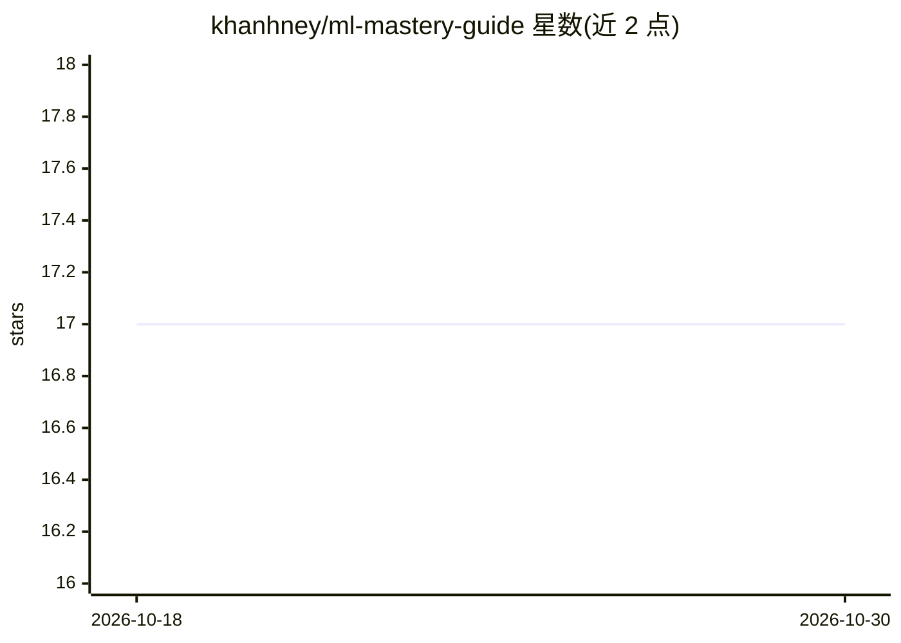

# khanhney/ml-mastery-guide

⭐ 17 · 推送 2025-12-13 · [GitHub](https://github.com/khanhney/ml-mastery-guide) · 个人维护

**机器学习与深度学习从零到生产的系统学习路线图**

面向学习者的 ML/DL 实践路线图，按 5 门课程组织：统计与数据基础、机器学习基础、机器学习进阶（集成方法、MLOps）、深度学习、NLP 与大语言模型。每门课程以表格列出主题、关键概念与行业用例，并给出按问题类型和数据规模选择算法的速查表。附带各课程的前置知识要求、工具库清单（Pandas、Scikit-learn、XGBoost、PyTorch、Hugging Face Transformers、LangChain 等）、配套实践项目（Titanic、CIFAR-10 等）与目录结构。MIT 许可，以 README 课程仓库形式提供，不含可安装的软件本体。

## 筛选速览

| 维度 | 判定 | 备注 |
|---|---|---|
| AI 角色 | `ai-knowledge` | 知识聚合/清单类 |
| 许可风险 | `none` | — |
| 部署形态 | `None` |  |
| 模型依赖 | — | README 未给出锁定关系 |
| 硬件要求 | — | 无带数字的原话,不猜 |
| 安装摩擦 | `low` | 无编译、无系统依赖或容器化 |
| 成熟度 | — | 结构信号不足 |

## 能力要点

- 5 门课程覆盖统计、经典 ML、进阶集成、深度学习与 NLP/LLM
- 按问题类型与数据规模的算法选择速查表
- 各课程列出前置知识、工具库与实践项目（含数据集）
- 声明遵循 80/20 原则组织学习内容

## 适用场景

- 系统规划从零到生产级 ML 工程者的学习路径
- 按问题类型快速查找候选算法与工具库
- 为每门课程配套数据集做实践项目

## 场景标签

`教程课程` · 领域:学习与行业

## 证据(README 行号)

> L3: ### The Complete Machine Learning & Deep Learning Roadmap
> L14: A comprehensive, practical roadmap for mastering Machine Learning and Deep Learning. Each course includes mathemati

## 星数曲线

2026-10-18 17 → 2026-10-30 17（+0）

---
*卡片 v1 · prompt 1.4 · 生成 2026-10-29 · 置信度 high · 依据 README sha `c562ed990ae4` · [字段定义](../../DATASET.md)*
