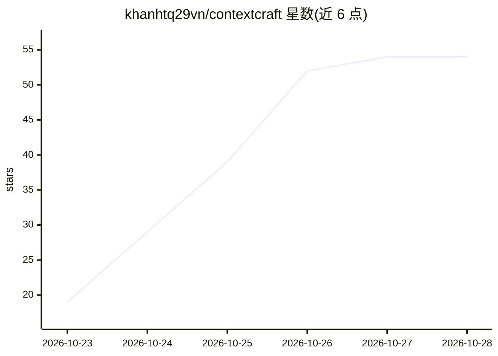

# khanhtq29vn/contextcraft

⭐ 56 · Python · MIT · 推送 2026-10-25 · [GitHub](https://github.com/khanhtq29vn/contextcraft) · [官网](https://khanhtq29vn.github.io/contextcraft/) · 个人维护

**面向 LLM 的 AST 感知、token 预算约束的代码库压缩工具**

面向开发者的代码库压缩器：用 Tree-sitter 解析 35 种语言与格式，解析跨文件作用域与导入，以 Personalized PageRank + BM25F 排序架构中心性，并在 4 个 AST 保真层级（FULL/SKEL/SIGS/TREE）上求解多选背包问题（MCKP），把仓库打包进指定 token 预算。提供 CLI、Python SDK 与交互式 Web Playground（可克隆压缩公开 GitHub 仓库），内置 SecretSanitizer 清除密钥。README 以 PyPI 包与 uvx 即时运行方式分发。

## 筛选速览

| 维度 | 判定 | 备注 |
|---|---|---|
| AI 角色 | `ai-ecosystem` | LLM/agent 周边工具 |
| 许可风险 | `permissive` | MIT |
| 部署形态 | `library` | 以包/库形式分发 |
| 模型依赖 | — | README 未给出锁定关系 |
| 硬件要求 | — | 无带数字的原话,不猜 |
| 安装摩擦 | `low` | 无编译、无系统依赖或容器化 |
| 成熟度 | — | 结构信号不足 |

## 能力要点

- Tree-sitter 解析 35 种语言与格式
- Personalized PageRank + BM25F 排序架构中心性
- 4 个 AST 保真层级上的 MCKP 预算优化求解
- SecretSanitizer 自动清除 API 密钥、PEM 块与高熵密钥

## 适用场景

- 把大仓库压缩进固定 token 预算后交给本地或云端 LLM
- 针对特定子系统定向调试时做代码上下文裁剪
- 在 Web Playground 中交互调整预算并检视 PageRank 分数

## 场景标签

 · 领域:LLM 工具链/代码上下文工程

## 证据(README 行号)

> L3: **AST-Aware, Dependency-Graph-Ranked, Token-Budgeted Semantic Codebase Compressor for LLMs**
> L16: **`ContextCraft` is the AST-aware "MarkItDown for Codebases"**. Instead of naive concatenation or arbitrary charact

## 星数曲线

2026-10-23 19 → 2026-10-28 54（+35）

---
*卡片 v1 · prompt 1.4 · 生成 2026-10-25 · 置信度 high · 依据 README sha `596557215587` · [字段定义](../../DATASET.md)*
