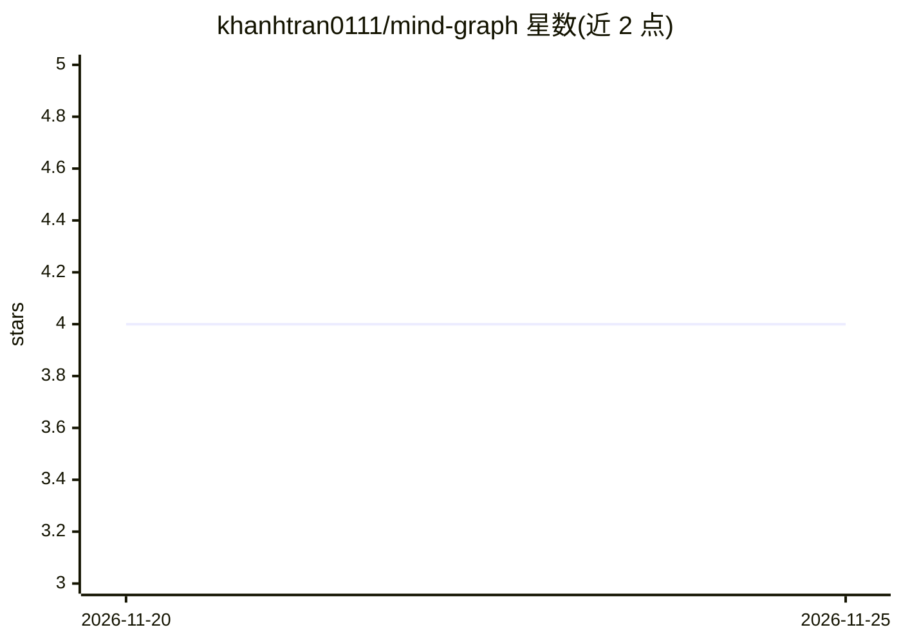

# khanhtran0111/mind-graph

⭐ 4 · Python · 推送 2026-11-18 · [GitHub](https://github.com/khanhtran0111/mind-graph) · 个人维护

**把代码库或文档文件夹转成离线思维导图与 agent 复用项目地图的技能**

一个供 Claude 及其他可运行 Python 的 agent 使用的 Agent Skill：扫描仓库、PDF/Word/PPT/Excel、Obsidian 笔记库等，读取关键部分后生成结构化 graph.json，并输出三种产物——可交互离线思维导图 HTML、供 agent 后续会话直接复用的 2–4k token 项目大纲 MINDGRAPH.md、Mermaid mindmap。节点携带逐字引用作为证据并做哈希校验，代码或文档变更后标记失效节点；针对论文复现仓库可将公式、算法步骤与超参数映射到实现代码并记录偏差，支持跨版本概念级 diff。

## 筛选速览

| 维度 | 判定 | 备注 |
|---|---|---|
| AI 角色 | `ai-native` | 本体是模型或模型工具 |
| 许可风险 | `none` | — |
| 部署形态 | `library` | 以包/库形式分发 |
| 模型依赖 | locked-api |  |
| 硬件要求 | — | 无带数字的原话,不猜 |
| 安装摩擦 | `low` | 无编译、无系统依赖或容器化 |
| 成熟度 | — | 结构信号不足 |

## 能力要点

- 三种输出：离线可交互 mindgraph.html、agent 复用的 MINDGRAPH.md、Mermaid mindmap
- 节点级证据：逐字引用哈希校验，变更后标记 ok/changed/stale
- 论文↔代码映射：公式、算法、超参数与实现的对照表与偏差记录
- 概念级版本 diff（graph diff）用于 PR 评审

## 适用场景

- 快速理解新接手的代码库并生成学习路径
- 把课程资料、论文、会议笔记整理成可导航的思维导图
- 论文复现时逐项核对代码与论文陈述的偏差
- 让 agent 新会话直接读项目地图而不重复探索

## 场景标签

`知识图谱` `知识库管理` `文档解析` · 领域:知识与检索

## 证据(README 行号)

> L9: `mind-graph` is an Agent Skill for Claude
> L17: |`mindgraph.html`|People|A self-contained, offline mind graph you can collapse, search and click through. Each node
> L18: |`MINDGRAPH.md`|Agents|A 2–4k-token outline that a new session reads *instead of* exploring the project again.|

## 星数曲线

2026-11-20 4 → 2026-11-25 4（+0）

---
*卡片 v1 · prompt 1.4 · 生成 2026-11-21 · 置信度 mid · 依据 README sha `b9ecf0634b78` · [字段定义](../../DATASET.md)*
