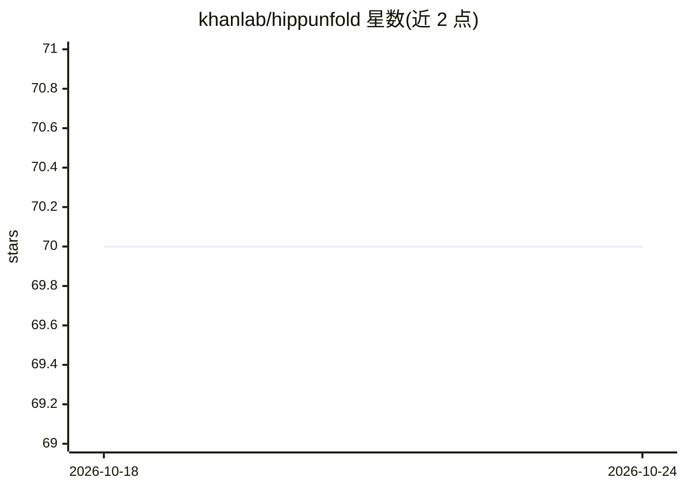

# khanlab/hippunfold

⭐ 70 · Python · MIT · 推送 2026-10-15 · [GitHub](https://github.com/khanlab/hippunfold) · [官网](https://hippunfold.readthedocs.io) · 组织维护

**海马体 MRI 自动展开与亚区分割的神经影像工具**

面向神经影像研究者的海马体处理流水线：对人类海马的拓扑折叠结构进行建模并计算展开，用于可视化、跨被试配准、基于展开图谱的分区，以及厚度/表面积/曲率等形态测量和定量制图。v2.0 更新表面精度、Laplace 坐标系与 U-net 模型（覆盖新生儿、阿尔茨海默病、对比度无关处理）。以 BIDS App 形式提供，通过 Pixi 从 conda-forge/khanlab/bioconda 渠道安装。

## 筛选速览

| 维度 | 判定 | 备注 |
|---|---|---|
| AI 角色 | `ai-native` | 本体是模型或模型工具 |
| 许可风险 | `permissive` | MIT |
| 部署形态 | `self-host` | docker 或自建部署 |
| 模型依赖 | — | README 未给出锁定关系 |
| 硬件要求 | — | 无带数字的原话,不猜 |
| 安装摩擦 | `low` | 无编译、无系统依赖或容器化 |
| 成熟度 | — | 结构信号不足 |

## 能力要点

- 海马体计算展开与拓扑约束的跨被试配准
- 基于展开图谱的亚区分区与形态测量（厚度/曲率等）
- v2.0 新增新生儿、阿尔茨海默病等场景的 U-net 模型
- 以 BIDS App/Snakemake 流水线形式提供

## 适用场景

- 对 MRI 数据做海马亚区自动分割
- 在展开坐标空间做跨被试配准与形态测量
- 将 qT1 等定量数据映射到海马中厚度表面

## 场景标签

`目标检测` · 领域:感知与多模态

## 证据(README 行号)

> L9: This tool aims to automatically model the topological folding structure
> L33: - New U-net models for neonates, Alzheimer's disease, contrast-agnostic processing, and more on the way

## 星数曲线

2026-10-18 70 → 2026-10-24 70（+0）

---
*卡片 v1 · prompt 1.4 · 生成 2026-10-24 · 置信度 mid · 依据 README sha `7f913e48b34a` · [字段定义](../../DATASET.md)*
