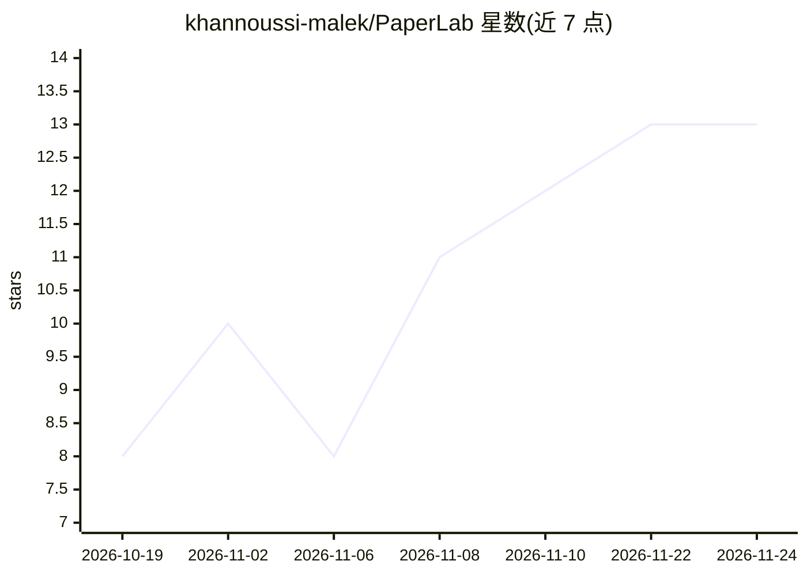

# khannoussi-malek/PaperLab

⭐ 13 · Python · Apache-2.0 · 推送 2026-11-22 · [GitHub](https://github.com/khannoussi-malek/PaperLab) · [官网](https://khannoussi-malek.github.io/PaperLab/) · 个人维护

**研究者的本地优先 PDF 阅读器：笔记锚定页面，AI 回答引用原文**

运行在本机的文献阅读工具：导入 PDF 后可高亮、做锚定到具体位置的笔记、按 Lens 分段阅读、查看引用关系图谱。AI 部分支持对单篇论文或整个 workspace 提问，回答以 [C1] 形式引用原文段落并可跳转定位；AI 生成内容与用户笔记分开存储并标记为 AI。对话模型可接本地 Ollama 或自带 key 的 Anthropic 及任意 OpenAI 兼容服务；长文先检索相关段落再送模型。依赖 Docker 运行，macOS 提供 Homebrew cask，Windows/Linux 有下载与源码途径。

## 筛选速览

| 维度 | 判定 | 备注 |
|---|---|---|
| AI 角色 | `ai-native` | 本体是模型或模型工具 |
| 许可风险 | `permissive` | Apache-2.0 |
| 部署形态 | `desktop` | 安装包/桌面程序 |
| 模型依赖 | local-ok | 支持本地模型 |
| 硬件要求 | — | 无带数字的原话,不猜 |
| 安装摩擦 | `low` | 无编译、无系统依赖或容器化 |
| 成熟度 | `idea` | |

## 能力要点

- AI 回答引用原文段落，点击引用跳转并定位到 PDF 页面
- 本地 Ollama 与多家 OpenAI 兼容服务可选，密钥留在本地数据库
- 笔记锚定页码与位置，AI 内容单独标记（You/AI/AI·edited）
- 内置 MCP server，支持 Claude 等客户端操作同一文献库

## 适用场景

- 读论文时高亮做笔记并保持与原文位置关联
- 向单篇论文提问并获得带出处引用的回答
- 构建文献库并用图谱查看引用与相似关系
- 让 Claude 通过 MCP 直接操作本地文献库

## 场景标签

`知识库管理` `科研工具` `文档问答` · 领域:知识与检索

## 证据(README 行号)

> L23: PaperLab is a research reading tool that runs on your own machine. You drop in PDFs, read them, highlight passages,
> L24: and write notes that stay attached to the exact spot they came from. You can ask a paper questions and get answers
> L162: - Pick the model for each question from the chat panel: a local Ollama model, Anthropic with your own key, or any

## 星数曲线

2026-10-19 8 → 2026-11-24 13（+5）

---
*卡片 v1 · prompt 1.4 · 生成 2026-11-18 · 置信度 mid · 依据 README sha `a873ee2c3489` · [字段定义](../../DATASET.md)*
