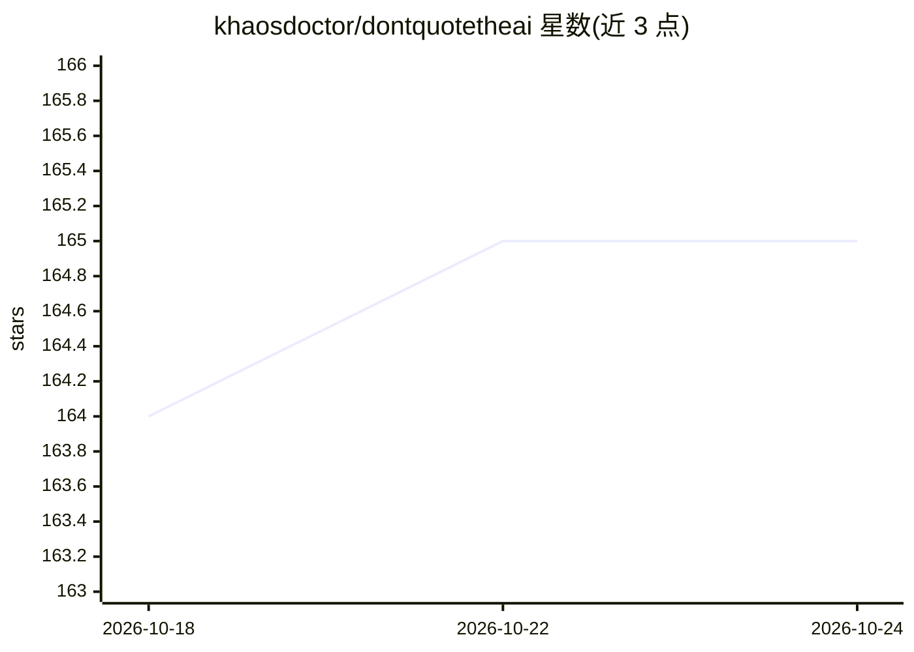

# khaosdoctor/dontquotetheai

⭐ 166 · HTML · MIT · 推送 2026-09-27 · [GitHub](https://github.com/khaosdoctor/dontquotetheai) · [官网](https://dontquotetheai.com) · 个人维护

**讽刺网站：发给直接粘贴 AI 长回答而不读的人**

静态 HTML 讽刺网站（dontpastetheai.com / dontquotetheai.com），主题是提醒人们不要未阅读就转发 AI 生成的长篇回答。提供温和版（/）与愤怒版（/angry/）两种语气页面及面向教师的学生页面，覆盖约 20+ 种语言翻译，由社区通过 PR 维护。技术机制：translations.json 作为语言单一来源，GitHub Actions CI 自动同步 hreflang、OG 图片与 SEO 文件，部署于 Cloudflare Workers Assets，本地开发仅需打开 index.html 或 python3 -m http.server。

## 筛选速览

| 维度 | 判定 | 备注 |
|---|---|---|
| AI 角色 | `ai-knowledge` | 知识聚合/清单类 |
| 许可风险 | `permissive` | MIT |
| 部署形态 | `None` |  |
| 模型依赖 | — | README 未给出锁定关系 |
| 硬件要求 | — | 无带数字的原话,不猜 |
| 安装摩擦 | `low` | 无编译、无系统依赖或容器化 |
| 成熟度 | — | 结构信号不足 |

## 能力要点

- 温和版与愤怒版双语气页面，互相交叉链接
- 约 20+ 种语言翻译，TRANSLATING.md 引导社区贡献
- 静态 HTML，CI 自动生成 hreflang/OG 图/SEO 并触发 Cloudflare 部署
- 面向教师的学生页面，针对未阅读就提交 AI 作业的学生

## 适用场景

- 把链接发给总粘贴 ChatGPT 长回答而不读的同事或朋友
- 教师提醒学生不要提交未阅读的 AI 生成作业
- 作为翻译贡献者参与多语言讽刺页面维护

## 场景标签

 · 领域:网络文化/静态网站

## 证据(README 行号)

> L6: A website you send to that one person who answers every question with eight hundred words of ChatGPT they clearly di
> L8: > **This is satire.** Nobody is being attacked, nobody is being cancelled, nobody hates AI, have some humor. Use the

## 星数曲线

2026-10-18 164 → 2026-10-24 165（+1）

---
*卡片 v1 · prompt 1.4 · 生成 2026-10-22 · 置信度 mid · 依据 README sha `cc05abcfcf94` · [字段定义](../../DATASET.md)*
