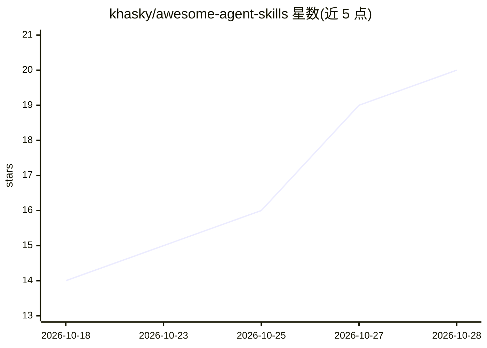

# khasky/awesome-agent-skills

⭐ 20 · Python · MIT · 推送 2026-10-20 · [GitHub](https://github.com/khasky/awesome-agent-skills) · 个人维护

**AI 编程 agent 技能清单：代码审查、调试、审计等 SKILL.md 集合**

面向 AI 编程 agent 的技能集合：每个技能是一个含 SKILL.md 的文件夹，覆盖代码审查、测试编写、设计文档、调试、安全/架构/性能等 12 类只读审计（输出 SHIP/FIX/BLOCK 判定）、Git 历史操作、文案写作与内容营销。技能提炼自公开合集与开源实践，兼容 Claude Code、Codex、Gemini CLI、Cursor、Copilot 等多种 agent。通过 npx skills CLI 或各 agent 的插件市场安装，部分技能间存在参考文件依赖。

## 筛选速览

| 维度 | 判定 | 备注 |
|---|---|---|
| AI 角色 | `ai-knowledge` | 知识聚合/清单类 |
| 许可风险 | `permissive` | MIT |
| 部署形态 | `library` | 以包/库形式分发 |
| 模型依赖 | — | README 未给出锁定关系 |
| 硬件要求 | — | 无带数字的原话,不猜 |
| 安装摩擦 | `low` | 无编译、无系统依赖或容器化 |
| 成熟度 | — | 结构信号不足 |

## 能力要点

- 每个技能为 Agent Skills 标准格式的 SKILL.md 文件夹
- 兼容 Claude Code、Codex、Gemini CLI、Cursor、Copilot 等十余种 agent
- 12 类审计技能均为只读并输出 SHIP/FIX/BLOCK 判定
- 提供 npx skills CLI 与各 agent 插件市场两种安装方式

## 适用场景

- 给 AI 编程 agent 配备代码审查、调试、测试编写能力
- 在开源或发布前对仓库做安全、隐私、供应链等只读审计
- 清理 AI 生成的代码与文本痕迹
- 改写 Git 历史或批量发布社媒内容（需显式点名触发）

## 场景标签

`代码审查` `提示工程` · 领域:Agent 开发

## 证据(README 行号)

> L7: Skills for AI coding agents: code review, test writing, design docs, debugging, security audits, refactoring, and cl
> L9: Works with Claude Code, Claude.ai, OpenAI Codex, Gemini CLI, Cursor, GitHub Copilot, opencode, Amp, Windsurf, Antigr

## 星数曲线

2026-10-18 14 → 2026-10-28 20（+6）

---
*卡片 v1 · prompt 1.4 · 生成 2026-10-28 · 置信度 high · 依据 README sha `c7f65d2a41a7` · [字段定义](../../DATASET.md)*
