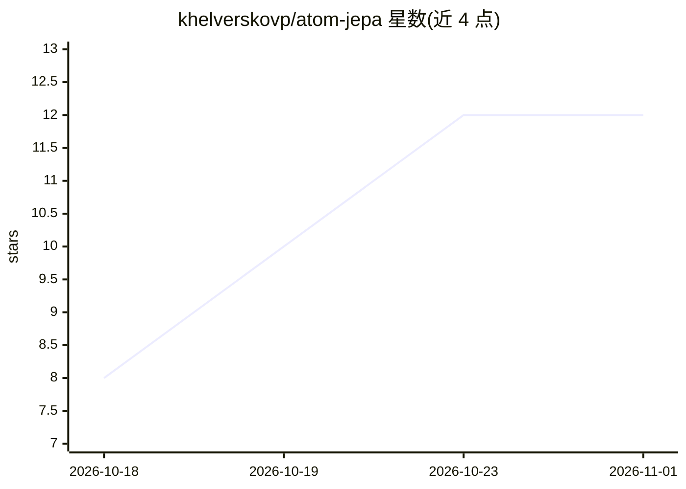

# khelverskovp/atom-jepa

⭐ 12 · Python · MIT · 推送 2026-10-07 · [GitHub](https://github.com/khelverskovp/atom-jepa) · [官网](https://arxiv.org/abs/2610.08400) · 组织维护

**3D 原子体系的自监督预训练模型：分子与晶体嵌入及性质预测**

Atom-JEPA 是面向 3D 原子体系（分子与无机晶体）的自监督预训练方法官方实现：将结构切分为互补的上下文与目标子图，由预测器从上下文预测目标潜表示（原子级与池化子结构级），预训练后将上下文编码器微调用于下游性质预测。以 PyPI 包（加载预训练编码器、嵌入结构、微调）与仓库（预训练与论文基准脚本）两种方式提供，编码器为 EquiformerV3，支持 SMILES/ase.Atoms/pymatgen 输入、CUDA GPU bf16 与 cuEquivariance 内核，基准覆盖 QM9、MatBench 与 ADMET。

## 筛选速览

| 维度 | 判定 | 备注 |
|---|---|---|
| AI 角色 | `ai-native` | 本体是模型或模型工具 |
| 许可风险 | `permissive` | MIT |
| 部署形态 | `library` | 以包/库形式分发 |
| 模型依赖 | — | README 未给出锁定关系 |
| 硬件要求 | — | 无带数字的原话,不猜 |
| 安装摩擦 | `medium` | 含编译或系统依赖之一 |
| 成熟度 | — | 结构信号不足 |

## 能力要点

- 上下文-目标子图交替的 JEPA 预训练配方，适用于分子与晶体
- 预训练编码器发布于 Hugging Face（Uni-Mol 19M 分子、Alexandria 1.7M 晶体）
- 支持 SMILES / ase.Atoms / pymatgen 输入的嵌入与自定义微调
- 提供 QM9 / MatBench / ADMET 基准微调与冻结编码器探测脚本

## 适用场景

- 为分子或晶体生成预训练嵌入用于下游建模
- 在自己的训练循环中微调编码器做性质预测
- 复现论文的 QM9/MatBench/ADMET 基准结果

## 场景标签

`模型训练` `微调` `模型评测` · 领域:评测与运维

## 证据(README 行号)

> L10: Atom-JEPA is a self-supervised pretraining method for 3D atomistic systems.
> L30: for downstream property prediction.

## 星数曲线

2026-10-18 8 → 2026-11-01 12（+4）

---
*卡片 v1 · prompt 1.4 · 生成 2026-11-01 · 置信度 high · 依据 README sha `17ce6fa8ae04` · [字段定义](../../DATASET.md)*
