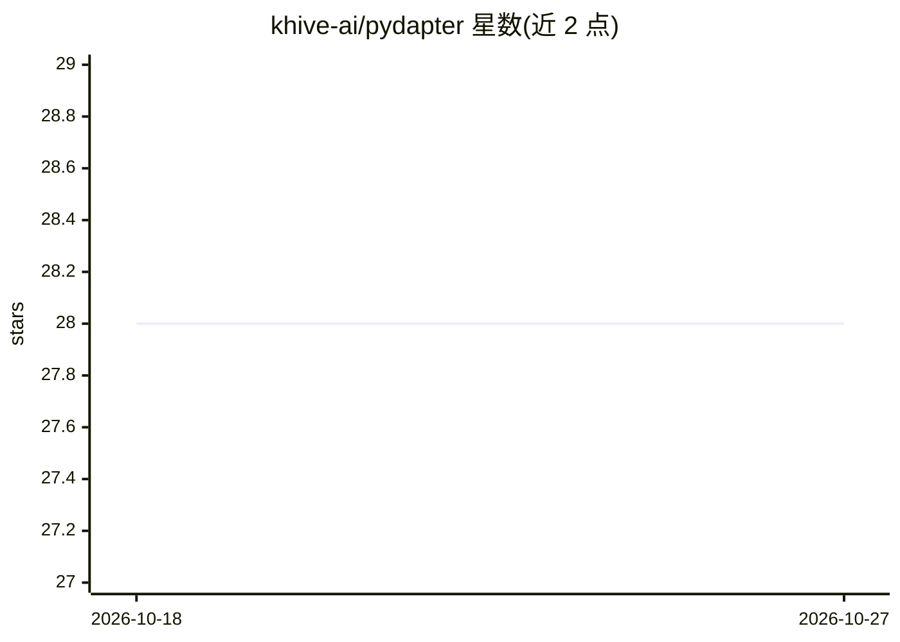

# khive-ai/pydapter

⭐ 28 · Python · Apache-2.0 · 推送 2026-04-27 · [GitHub](https://github.com/khive-ai/pydapter) · [官网](https://khive-ai.github.io/pydapter/) · 组织维护

**Python 数据格式与存储适配库：一套接口读写多种数据库和文件**

基于 Pydantic 模型的数据适配层，通过 Adapter.from_obj / to_obj 统一接口在 PostgreSQL、MySQL、SQLite、MongoDB、DynamoDB、Qdrant、Weaviate、Pinecone、Neo4j、ArangoDB 及 JSON/CSV/Excel/Parquet 文件之间读写数据，主要适配器支持异步操作与连接池。面向需要多存储后端（如 LLM 管线中 SQL+向量+图数据库组合）的开发者，宣称通过 pip 安装，支持 extras 按需集成与自定义 Adapter 扩展，采用 Apache-2.0 许可。

## 筛选速览

| 维度 | 判定 | 备注 |
|---|---|---|
| AI 角色 | `ai-ecosystem` | LLM/agent 周边工具 |
| 许可风险 | `permissive` | Apache-2.0 |
| 部署形态 | `library` | 以包/库形式分发 |
| 模型依赖 | — | README 未给出锁定关系 |
| 硬件要求 | — | 无带数字的原话,不猜 |
| 安装摩擦 | `low` | 无编译、无系统依赖或容器化 |
| 成熟度 | — | 结构信号不足 |

## 能力要点

- 统一 from_obj/to_obj 接口覆盖 SQL、NoSQL、向量库、图数据库与文件格式
- 主要适配器支持异步操作与连接池
- 兼容 Pydantic 之外的模型框架（如 dataclass），支持自定义序列化方法
- 可通过继承 Adapter 基类编写自定义适配器

## 适用场景

- LLM 数据管线中把同一批实体同时写入 SQL、向量库与图数据库
- 同一套代码在不同环境（本地 PostgreSQL / AWS DynamoDB / 边缘 SQLite）部署
- MongoDB 到 PostgreSQL 等存储间的渐进式迁移

## 场景标签

 · 领域:数据基础设施/LLM 数据管线

## 证据(README 行号)

> L75: data = Adapter.from_obj(YourModel, source_config, many=True)
> L121: |**Vector Stores**|Qdrant, Weaviate, Pinecone|✅|

## 星数曲线

2026-10-18 28 → 2026-10-27 28（+0）

---
*卡片 v1 · prompt 1.4 · 生成 2026-10-26 · 置信度 high · 依据 README sha `5a35c5b9758f` · [字段定义](../../DATASET.md)*
