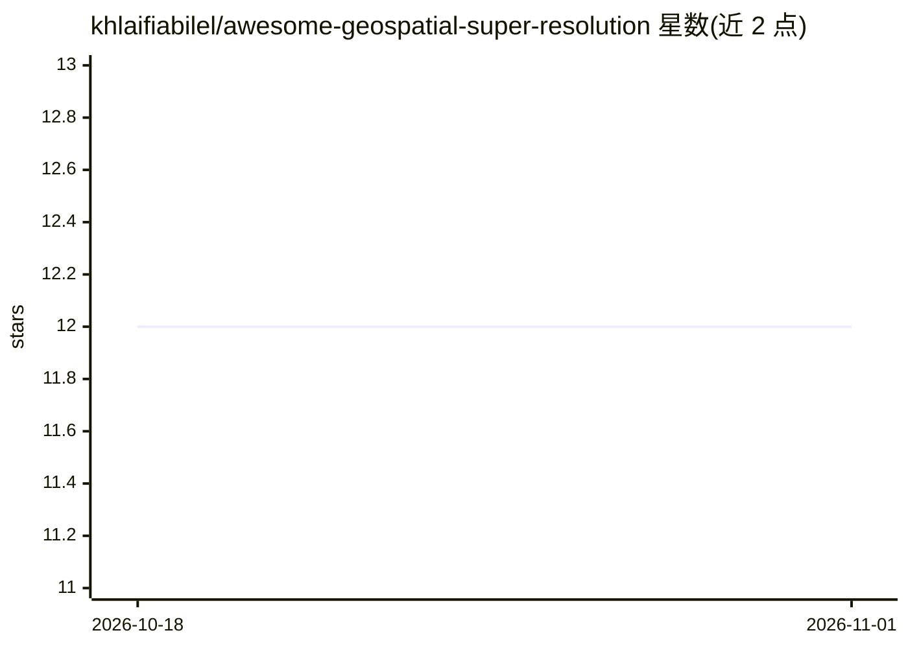

# khlaifiabilel/awesome-geospatial-super-resolution

⭐ 12 · CC0-1.0 · 推送 2026-08-03 · [GitHub](https://github.com/khlaifiabilel/awesome-geospatial-super-resolution) · 个人维护

**遥感/对地观测超分辨率算法、数据集与论文策展清单**

个人维护的 awesome list，汇集地理空间超分辨率领域的算法、数据集、模型与论文资源。按问题类型组织：单图/多图超分、全色锐化、多分辨率波段锐化、跨传感器融合、高光谱与热红外融合、SAR 超分等；方法覆盖经典重建（IBP/MAP/ATPRK）、CNN/GAN/Transformer/扩散模型骨干，并列出 Sen2Venµs、WorldStrat 等真实 LR–HR 配对数据集。面向遥感与深度学习研究者的选型参考，本身不含可运行代码。

## 筛选速览

| 维度 | 判定 | 备注 |
|---|---|---|
| AI 角色 | `ai-knowledge` | 知识聚合/清单类 |
| 许可风险 | `viral` | CC0-1.0 |
| 部署形态 | `library` | 以包/库形式分发 |
| 模型依赖 | — | README 未给出锁定关系 |
| 硬件要求 | — | 无带数字的原话,不猜 |
| 安装摩擦 | `low` | 无编译、无系统依赖或容器化 |
| 成熟度 | — | 结构信号不足 |

## 能力要点

- 按 8 类问题设置（SISR/MISR/全色锐化/跨传感器融合等）组织方法分类
- 收录经典方法、深度模型骨干与真实 LR–HR 配对数据集条目
- 包含盲超分退化建模与不确定性/幻觉评估的实践建议

## 适用场景

- 为遥感超分辨率研究挑选算法骨干与基准数据集
- 查找 Sentinel-2 波段锐化或跨传感器融合的可用方法
- 了解该领域的退化建模与幻觉评估实践

## 场景标签

`精选清单` `图像视频处理` · 领域:学习与行业

## 证据(README 行号)

> L3: > A curated list of algorithms, datasets, models, code, papers, and resources for **super-resolution (SR) of geospat
> L133: ## Datasets

## 星数曲线

2026-10-18 12 → 2026-11-01 12（+0）

---
*卡片 v1 · prompt 1.4 · 生成 2026-11-01 · 置信度 mid · 依据 README sha `f048b8c71a60` · [字段定义](../../DATASET.md)*
