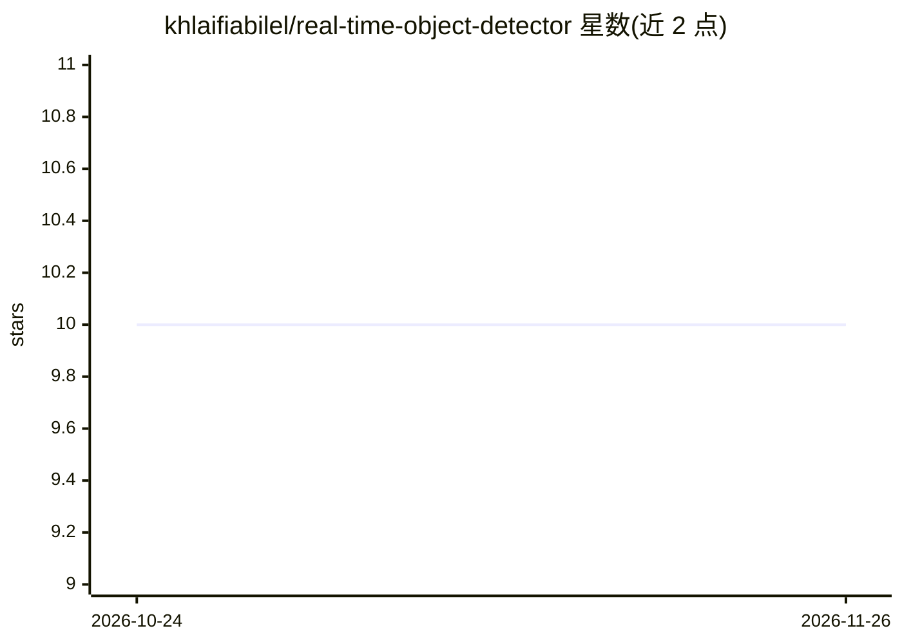

# khlaifiabilel/real-time-object-detector

⭐ 10 · Python · MIT · 推送 2026-07-31 · [GitHub](https://github.com/khlaifiabilel/real-time-object-detector) · 个人维护

** webcam 实时目标检测示例：预训练 MobileNet SSD + OpenCV DNN**

教学性质示例仓库：用 OpenCV DNN 模块运行预训练 Caffe 格式 MobileNet SSD 模型，对摄像头画面做实时目标检测，覆盖 PASCAL VOC 20 类。支持配置摄像头索引与置信度阈值，自带模型文件与 SHA-256 校验、免摄像头的合成图像冒烟测试。README 明确声明这是教学示例而非持续维护的应用，模型资产出自 2020 年，仅支持实时摄像头输入，无录制或结构化导出，需 OpenCV 4（OpenCV 5 已移除 Caffe importer）。

## 筛选速览

| 维度 | 判定 | 备注 |
|---|---|---|
| AI 角色 | `ai-native` | 本体是模型或模型工具 |
| 许可风险 | `permissive` | MIT |
| 部署形态 | `library` | 以包/库形式分发 |
| 模型依赖 | — | README 未给出锁定关系 |
| 硬件要求 | — | 无带数字的原话,不猜 |
| 安装摩擦 | `medium` | 含编译或系统依赖之一 |
| 成熟度 | `idea` | |

## 能力要点

- 通过 OpenCV DNN 运行预训练 Caffe 格式 MobileNet SSD
- 可配置摄像头索引与置信度阈值
- 自带模型文件及 SHA-256 校验信息
- 提供无需摄像头的合成图像推理测试

## 适用场景

- 学习 OpenCV DNN 模块的实时目标检测用法
- 在笔记本摄像头场景跑 20 类 VOC 目标检测演示
- 复用 2020 年代 Caffe 模型资产做教学实验

## 场景标签

`目标检测` · 领域:感知与多模态

## 证据(README 行号)

> L3: Legacy Python example for running a pretrained MobileNet SSD object detector on frames from a webcam using OpenCV's 
> L11: - MobileNet SSD inference through OpenCV DNN
> L102: - Detection accuracy and speed depend on the model, camera, scene, and host hardware.

## 星数曲线

2026-10-24 10 → 2026-11-26 10（+0）

---
*卡片 v1 · prompt 1.4 · 生成 2026-11-19 · 置信度 high · 依据 README sha `98621d195bbb` · [字段定义](../../DATASET.md)*
