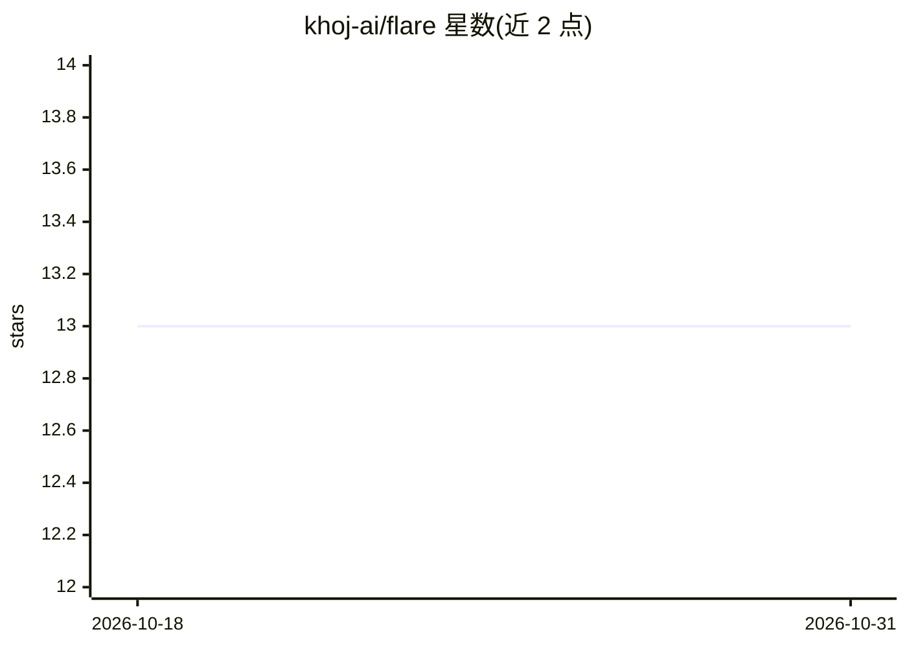

# khoj-ai/flare

⭐ 13 · Astro · 推送 2025-12-28 · [GitHub](https://github.com/khoj-ai/flare) · [官网](https://blog.khoj.dev) · 组织维护

**Khoj 官方博客站点：基于 Astro 的静态博客页面**

Khoj 项目（khoj-ai 组织）的所有博客相关页面仓库，使用 Astro 框架构建，基于 Bear Blog 主题模板。内容由 src/content/blog/ 目录下的 Markdown/MDX 文档集合构成，通过 getCollection() 检索文章，页面路由由 src/pages/ 下的 .astro/.md 文件生成。提供 yarn install/dev/build/preview 等命令用于本地开发与构建生产站点。仓库本身不包含 AI 功能代码，是面向发布内容的静态站点工程。

## 筛选速览

| 维度 | 判定 | 备注 |
|---|---|---|
| AI 角色 | `ai-knowledge` | 知识聚合/清单类 |
| 许可风险 | `none` | — |
| 部署形态 | `None` |  |
| 模型依赖 | — | README 未给出锁定关系 |
| 硬件要求 | — | 无带数字的原话,不猜 |
| 安装摩擦 | `low` | 无编译、无系统依赖或容器化 |
| 成熟度 | — | 结构信号不足 |

## 能力要点

- Astro 框架 + Bear Blog 主题的静态博客
- Markdown/MDX 内容集合（Content Collections）组织博文
- 提供 yarn dev/build/preview 开发与构建命令

## 适用场景

- 查看 Khoj 项目发布的博客文章
- 为 Khoj 博客撰写或修改内容并本地预览
- 构建并部署该博客的生产版本

## 场景标签

 · 领域:网站/内容发布

## 证据(README 行号)

> L1: # Khoj Blog
> L3: This was built with astro and is based on the Bear Blog theme.

## 星数曲线

2026-10-18 13 → 2026-10-31 13（+0）

---
*卡片 v1 · prompt 1.4 · 生成 2026-10-31 · 置信度 low · 依据 README sha `50f035258e6d` · [字段定义](../../DATASET.md)*
