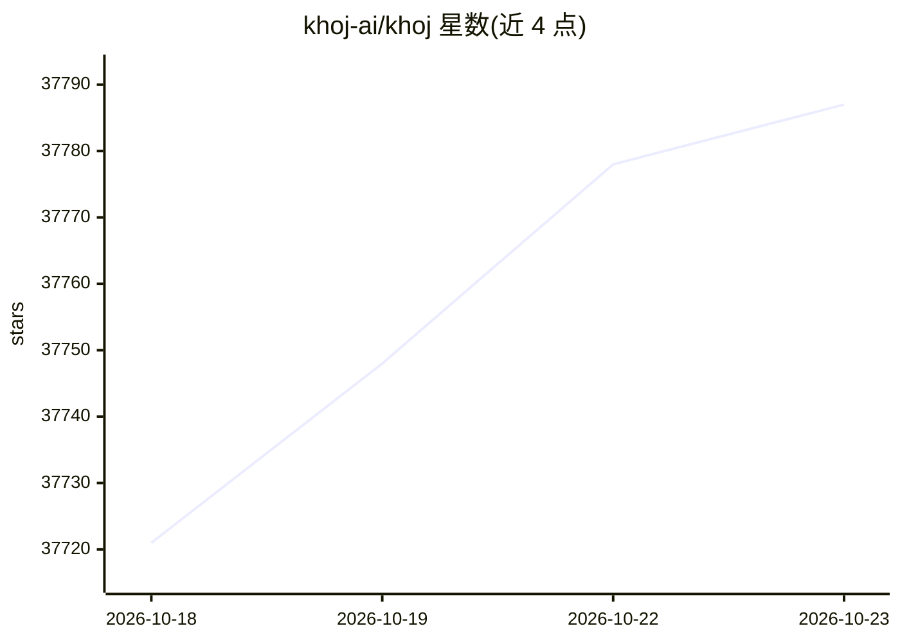

# khoj-ai/khoj

⭐ 37,787 · Python · AGPL-3.0 · 推送 2026-08-02 · [GitHub](https://github.com/khoj-ai/khoj) · [官网](https://khoj.dev) · 组织维护

**自托管的个人 AI 第二大脑：检索文档与网络、构建自定义 agent**

Khoj 是一个可自托管的个人 AI 应用，支持接入本地或在线 LLM，从互联网和本地文档（PDF、Markdown、Notion、Word、org-mode 等）中检索并回答问题；可创建带有自定义知识、persona、聊天模型与工具的 agent，支持定时自动化研究与通知。可通过浏览器、Obsidian、Emacs、桌面、手机或 WhatsApp 访问，提供云端版本供免安装使用，另有面向企业的云/本地/混合部署形态。

## 筛选速览

| 维度 | 判定 | 备注 |
|---|---|---|
| AI 角色 | `ai-native` | 本体是模型或模型工具 |
| 许可风险 | `viral` | AGPL-3.0 |
| 部署形态 | `library` | 以包/库形式分发 |
| 模型依赖 | — | README 未给出锁定关系 |
| 硬件要求 | — | 无带数字的原话,不猜 |
| 安装摩擦 | `low` | 无编译、无系统依赖或容器化 |
| 成熟度 | — | 结构信号不足 |

## 动量与使用信号

- 维护:`active` — 距上次 push 77.2 天,年发版 12,73 位贡献者
- 涨星:近 1 天 **+22**(自 20261016 起算)

## 能力要点

- 支持 llama3、qwen、mistral、gpt、claude、gemini、deepseek 等本地或在线 LLM
- 读取 PDF、Markdown、Notion、Word、org-mode 等多种文档并做语义搜索
- 创建自定义知识、persona、模型与工具的 agent，支持自动化研究任务
- 支持自托管，也提供云端直接使用入口

## 适用场景

- 在 Obsidian/Emacs 中对个人笔记与文档提问
- 自托管私有 AI 助手并接入本地模型
- 让 agent 定时执行研究并推送通知

## 场景标签

`AI 助手` `RAG` `图像生成` · 领域:对话与助手

## 证据(README 行号)

> L28: Khoj is a personal AI app to extend your capabilities. It smoothly scales up from an on-device personal AI to a clo
> L30: - Chat with any local or online LLM (e.g llama3, qwen, gemma, mistral, gpt, claude, gemini, deepseek).
> L37: - Khoj is open-source, self-hostable. Always.

## 星数曲线

2026-10-18 37,721 → 2026-10-23 37,787（+66）

---
*卡片 v1 · prompt 1.4 · 生成 2026-10-18 · 置信度 high · 依据 README sha `c0e986472ac6` · [字段定义](../../DATASET.md)*
