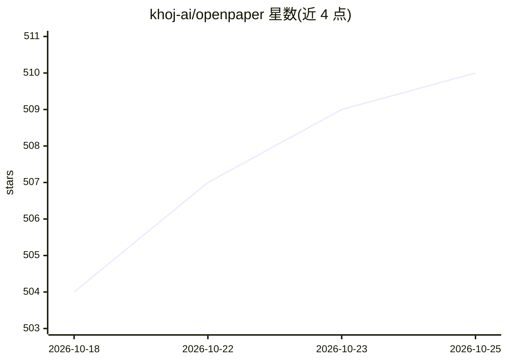

# khoj-ai/openpaper

⭐ 510 · Python · AGPL-3.0 · 推送 2026-10-24 · [GitHub](https://github.com/khoj-ai/openpaper) · [官网](https://openpaper.ai) · 组织维护

**研究论文阅读与文献综述的 AI 工作台应用**

面向研究者的论文阅读工作区：上传 PDF 后由 AI 助手生成摘要与引导问题，回答均带可点击溯源的引文（关联 ResearchQA 引文基准评测）；支持高亮批注、笔记、按项目组织论文并跨论文提问、自定义 schema 的数据表格提取与 CSV 导出，以及开放获取文献检索、Zotero 同步和论文音频概览生成。以托管服务为主，开源 AGPL-3.0 可自托管，但自托管需自行组装 Postgres、S3 兼容存储、LLM API key 与后台 worker。

## 筛选速览

| 维度 | 判定 | 备注 |
|---|---|---|
| AI 角色 | `ai-native` | 本体是模型或模型工具 |
| 许可风险 | `viral` | AGPL-3.0 |
| 部署形态 | `None` |  |
| 模型依赖 | — | README 未给出锁定关系 |
| 硬件要求 | — | 无带数字的原话,不猜 |
| 安装摩擦 | `low` | 无编译、无系统依赖或容器化 |
| 成熟度 | — | 结构信号不足 |

## 能力要点

- AI 回答附带可点击跳转原文的上下文引文
- 项目级跨论文问答与自定义 schema 的数据表格提取
- 开放获取文献检索与 Zotero 库导入同步
- 生成论文音频概览

## 适用场景

- 在阅读论文时用 AI 助手解释术语与段落并溯源原文
- 把相关论文组成项目做跨文献综述问答
- 批量提取论文关键字段导出 CSV 分析

## 场景标签

`科研工具` `文档问答` · 领域:知识与检索

## 证据(README 行号)

> L5: Open Paper is a workspace for reading research. Upload your papers, highlight and annotate them, take notes, and ask
> L21: Your paper and the AI assistant sit side by side, so you never leave the document. As soon as you upload a PDF, you

## 星数曲线

2026-10-18 504 → 2026-10-25 510（+6）

---
*卡片 v1 · prompt 1.4 · 生成 2026-10-21 · 置信度 high · 依据 README sha `9282409aa4a0` · [字段定义](../../DATASET.md)*
