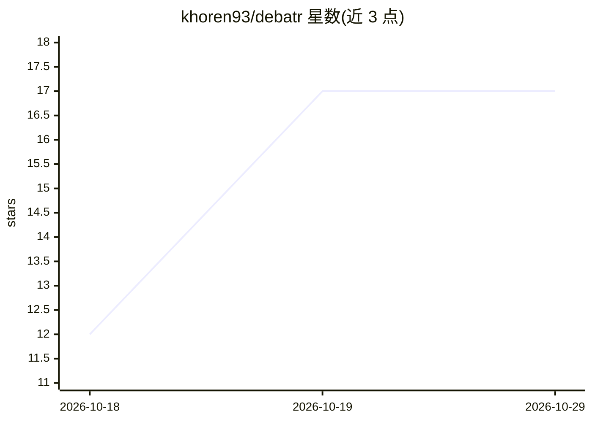

# khoren93/debatr

⭐ 17 · Python · MIT · 推送 2026-10-26 · [GitHub](https://github.com/khoren93/debatr) · [官网](https://debatr.tv) · 个人维护

**让任意 LLM 互辩并生成视频的全栈平台，面向创作者**

基于 OpenRouter 的全栈辩论编排服务：任选数百个模型配上人格、立场与语音进行辩论或说唱对决，参数流式实时呈现，AI 裁判给出裁决，观众盲投票形成 Elo 模型排行榜，并在浏览器内渲染 16:9 视频、9:16 短片、字幕与 MP3。支持 Stripe 充值或自带 OpenRouter key，提供公共画廊、iframe/oEmbed 嵌入。另有 PyPI 上的 debatr CLI 与 MCP server 供脚本和 agent 调用；限制：本地模型（Ollama）仍在路线图未实现。

## 筛选速览

| 维度 | 判定 | 备注 |
|---|---|---|
| AI 角色 | `ai-native` | 本体是模型或模型工具 |
| 许可风险 | `permissive` | MIT |
| 部署形态 | `self-host` | docker 或自建部署 |
| 模型依赖 | locked-api |  |
| 硬件要求 | — | 无带数字的原话,不猜 |
| 安装摩擦 | `low` | 无编译、无系统依赖或容器化 |
| 成熟度 | — | 结构信号不足 |

## 能力要点

- 数百个 OpenRouter 模型任意对辩，含人格/立场/语音配置与 AI 裁判
- 浏览器内渲染 16:9 视频与 9:16 短片，附字幕、MP3 与 YouTube 发布素材
- 网络搜索事实核查与观众盲投票驱动的 Elo 模型排行榜
- debatr CLI（uv 安装）与 MCP server，供终端脚本和 Claude/Cursor 等 agent 调用

## 适用场景

- 生成 AI 模型对决的辩论或说唱视频内容
- 通过观众投票查看哪些模型的论证表现更好
- 让 Claude/Cursor 等 agent 调用辩论工具做决策压力测试

## 场景标签

`模型评测` · 领域:评测与运维

## 证据(README 行号)

> L18: **Debatr** is a full-stack service that orchestrates structured debates between AI personas and turns them into con
> L4:  Stage debates between any LLMs on OpenRouter, watch them argue live with charts and fact-checks,

## 星数曲线

2026-10-18 12 → 2026-10-29 17（+5）

---
*卡片 v1 · prompt 1.4 · 生成 2026-10-29 · 置信度 mid · 依据 README sha `1dde474109a5` · [字段定义](../../DATASET.md)*
