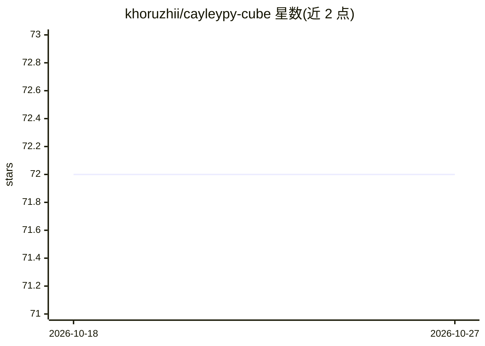

# khoruzhii/cayleypy-cube

⭐ 72 · Python · MIT · 推送 2025-11-09 · [GitHub](https://github.com/khoruzhii/cayleypy-cube) · 组织维护

**科研：训练神经网络在大型 Cayley 图上找短路径**

NeurIPS 2025 Spotlight 论文的 PyTorch 实现仓库：端到端流水线覆盖数据生成→训练→搜索，训练扩散距离预测网络并用其引导 GPU 批处理 beam search，在大规模 Cayley 图（魔方、Pancake、Klotski 等置换谜题）上求解短路径，方法为零人类知识（不依赖手工启发式）。同一流水线可跨不同 Cayley 图复用；README 给出预训练模型测试、自定义训练与新增谜题的命令，并提供 30+ 预定义谜题组与多 agent 评估脚本。面向组合优化与深度学习方向的研究者。

## 筛选速览

| 维度 | 判定 | 备注 |
|---|---|---|
| AI 角色 | `ai-native` | 本体是模型或模型工具 |
| 许可风险 | `permissive` | MIT |
| 部署形态 | `None` |  |
| 模型依赖 | — | README 未给出锁定关系 |
| 硬件要求 | — | 无带数字的原话,不猜 |
| 安装摩擦 | `low` | 无编译、无系统依赖或容器化 |
| 成熟度 | — | 结构信号不足 |

## 能力要点

- 扩散距离预测器 + GPU 批处理 beam search 架构
- 零人工知识：同一模型架构与超参跨多种 Cayley 图工作
- 覆盖魔方 2×2×2 至 6×6×6、Wreath、Globe、Pancake 等 30+ 谜题组
- 多 agent 训练/测试/集成统计的自动化脚本

## 适用场景

- 复现论文中各谜题的求解结果
- 为自己的置换谜题训练求解模型并做 beam search 评测
- 与 DeepCubeA / EfficientCube 在相同 scramble 数据集上做基准对比

## 场景标签

`科研工具` `模型训练` · 领域:学习与行业

## 证据(README 行号)

> L7: **Lightweight, end-to-end PyTorch pipeline** — data generation → training → search — all in `torch`, optimized for m
> L9:  Architecture: diffusion-distance predictor + batched beam search

## 星数曲线

2026-10-18 72 → 2026-10-27 72（+0）

---
*卡片 v1 · prompt 1.4 · 生成 2026-10-24 · 置信度 high · 依据 README sha `849fad212de4` · [字段定义](../../DATASET.md)*
