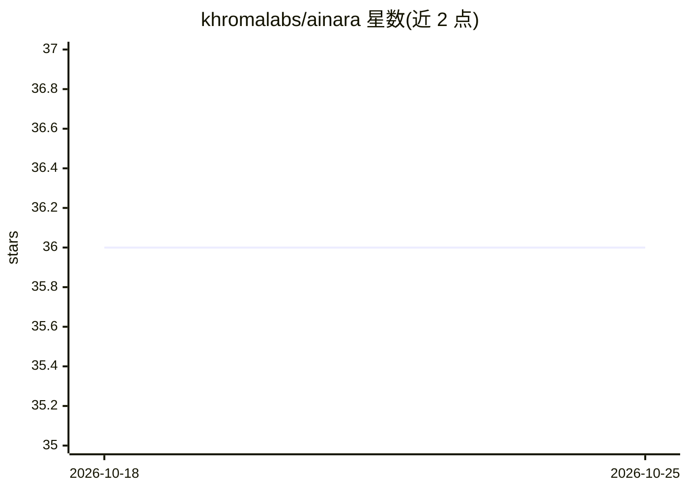

# khromalabs/ainara

⭐ 36 · Python · LGPL-3.0 · 推送 2026-10-24 · [GitHub](https://github.com/khromalabs/ainara) · [官网](https://ainara.app) · 组织维护

**本地优先的桌面 AI 伙伴框架：编排 AI agent 并热切换本地/远程模型**

客户端-服务器架构的模块化 AI 集成平台：Electron 桌面端 Polaris、技能路由服务 Orakle、承载记忆与语音的 Python 桥 PyBridge、以及负责 DAG agent 编排与定时任务（Sentinel 模式）的 Bureau。技能与 LLM 均可在本地或远程运行且运行时可热切换，支持 MCP 第三方服务器，对话持续记录为单一长会话。通过 Nexus Apps 机制安装第三方技能包（Solana 链上签名与本地许可校验），从源码运行需 Python 3.12 + Node.js，首次 setup 下载约 354 MB 的 Kokoro TTS 模型。

## 筛选速览

| 维度 | 判定 | 备注 |
|---|---|---|
| AI 角色 | `ai-ecosystem` | LLM/agent 周边工具 |
| 许可风险 | `viral` | LGPL-3.0 |
| 部署形态 | `library` | 以包/库形式分发 |
| 模型依赖 | — | README 未给出锁定关系 |
| 硬件要求 | — | 无带数字的原话,不猜 |
| 安装摩擦 | `low` | 无编译、无系统依赖或容器化 |
| 成熟度 | — | 结构信号不足 |

## 能力要点

- LLM 提供方与技能均可在运行时本地/远程热切换
- GREEN 持久化记忆网络与持续对话记录（可随时关闭）
- MCP 兼容的技能系统与第三方 Nexus Apps（链上签名校验）
- 无 UI 的 Sentinel 无头模式用于定时 agent 编排任务

## 适用场景

- 在桌面运行一个数据保留在本地的 AI 伙伴与助手
- 定时执行编排好的 agent 任务计划
- 通过编写 Python 模块扩展自定义技能

## 场景标签

`AI 助手` `Agent 框架` · 领域:Agent 开发

## 证据(README 行号)

> L12: **Ainara is an AI assistant, but not only an assistant. It's an AI companion, but not only an AI companion. It's no
> L19: - **Skills can be local or remote** (MCP protocol); the AI model can be local or remote — everything hot-swappable 
> L80: - Individual agentic tasks and DAG-based agent orchestration plans

## 星数曲线

2026-10-18 36 → 2026-10-25 36（+0）

---
*卡片 v1 · prompt 1.4 · 生成 2026-10-25 · 置信度 mid · 依据 README sha `9bcd42aa45dc` · [字段定义](../../DATASET.md)*
